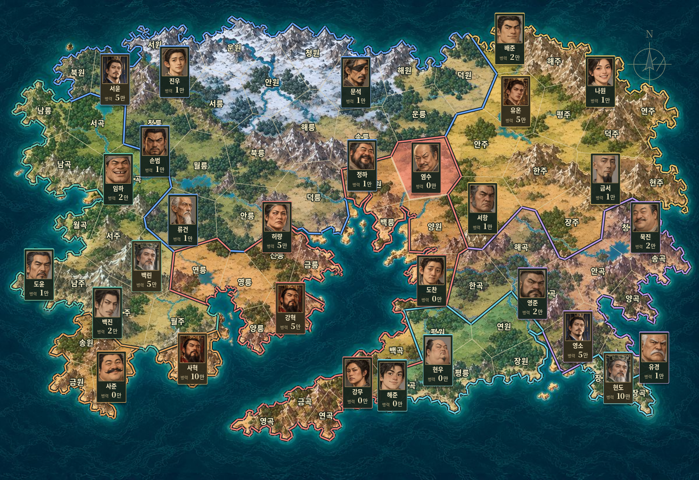

# 사국쟁패 Studio v0.4.0 · 자유 대륙과 지휘관 이동

사용자가 국가·인물·영토·규칙을 편집하고 자동 역사를 관찰하는 프로그램입니다. **이번 버전의 기본 시스템은 첨부된 `saguk-play (6).html`과 칠국쟁패 룰북 v11입니다.** 이전 Studio의 간소화한 국가 통합 병력 규칙을 원본의 장군별 부대·주둔지·생산·전투·후임 체계로 교체했습니다.



## 설치 없이 실행

**[바로 플레이할 HTML 파일 다운로드](https://github.com/doododoo123-create/-/raw/refs/tags/v0.4.0/%EC%82%AC%EA%B5%AD%EC%9F%81%ED%8C%A8%20Studio.html)**

링크를 우클릭해 **다른 이름으로 링크 저장**을 선택한 뒤, 받은 HTML을 Chrome 또는 Edge로 열면 됩니다. ZIP 압축을 풀 필요가 없습니다. 앞으로도 수정본은 단일 HTML을 별도로 제공합니다.

소스코드도 함께 받으려면 다음 ZIP 방법을 사용하세요.

1. GitHub의 **Code → Download ZIP**으로 받습니다.
2. ZIP 압축을 풉니다.
3. 폴더 안의 **`사국쟁패 Studio.html`**을 Chrome 또는 Edge로 엽니다.
4. **시뮬레이션 → 한 턴 진행**을 누릅니다.

`index.html`은 개발용입니다. 일반 사용자는 `사국쟁패 Studio.html`을 여세요. 실행에 계정·외부 서비스·인터넷·Node 설치가 필요하지 않습니다. 이 클라우드에서는 HTTP로 받은 단일 HTML의 오프라인 동작을 검증했습니다. 실제 Windows에서 파일을 더블클릭하는 검증은 수행하지 않았습니다.

## 이번 수정: 자유 대륙과 출정·복귀

- **참고 그림을 바탕으로 새 대륙:** 큰 남쪽 만, 두 반도, 해협과 구불구불한 해안을 갖춘 삽화 지도와 짙은 청록색 파도 바다입니다. 원본 사진의 픽셀 복사본은 아니며 참고하여 제작한 새 삽화입니다.
- **격자 제한 해제:** 자유 지도는 영토 수·위치·경계를 행·열과 독립적으로 저장합니다. **＋ 영토 그리기**, **영토 삭제**, **영토 통째로 이동**을 사용할 수 있습니다. 영토는 1~480개입니다.
- **실제 연결 편집:** 새 대륙은 맞닿은 경계로 연결했습니다. **맞닿은 경계로 연결**로 다시 계산하거나 **인접 관계**에서 해상 연결 등을 직접 지정합니다. 모양을 옮기거나 다시 그린 뒤에는 이 연결도 확인하세요.
- **지휘관 출정:** 공격 전에 카드가 연결된 자국 영토를 따라 전선 근처의 임시 주둔지로 이동합니다. 담당 지역을 공격받으면 방어 장군이 원래 주둔지로 복귀합니다. 이동 중에만 짧게 ‘출정’·‘복귀 · 방어’와 경로를 표시합니다.
- **원본 판정 유지:** 임시 주둔은 화면 연출입니다. 실제 담당 구역·수도 연결·보급·전투 수치와 난수를 변경하지 않습니다. 단절되어 자국 경로가 없으면 적 영토를 가로질러 이동하지 않습니다. 같은 역사에서는 같은 이동이 재현되고 완료 턴 저장 후에도 임시 위치를 복원합니다.
- 장수 초상화 50종, 작은 세로 카드, 화면에서 후임 접미사 숨김, 중앙 공격/수비 주사위와 실제 병력 변화 표시를 유지합니다.


기존 저장 세계와 경기는 그대로 엽니다. 기존 **80개 영토 세계**에서 **지도 · 영토 → 참고 대륙 적용**을 누르면 국가·인물·영토 이름·규칙을 보존하면서 지도 배치와 연결을 바꿉니다. 이 작업은 편집 되돌리기로 복구할 수 있습니다. 영토 수가 다른 세계는 **새 세계 만들기 → 참고 그림의 자유 대륙**에서 새 예제를 열거나 직접 그립니다. 진행 중 경기에는 **새 실행**부터 반영됩니다.

## 칠목과 청동 UI

제공한 `사국쟁패_UI이미지_77종.zip`의 **먹빛 바탕·청동 프레임·주홍/옥색 버튼**을 적용했습니다. 지도 프레임, 인물 초상 프레임, 육각 주사위, 명령 현판과 전투 배너, 국가 깃발·장군 표식, 종이 바탕 기록과 아이콘을 사용합니다. 작은 버튼은 모서리를 보존하고 기본·호버·눌림·비활성 상태를 구분합니다.

이름·병력·주사위는 실제 텍스트입니다. 보정 후 10 초과 숫자와 눈금이 높아질수록 붉어지는 효과를 유지합니다. 지도 전체화면은 상시 장식 프레임·우측 패널 없이 지도만 표시하고 판정 중에만 중앙 인물·주사위를 보여줍니다. 기존 편집 세계·저장·v11 계산은 그대로 사용합니다.


## 지도 그림과 경계 편집

**지도 · 영토**에서 산맥·숲이 보이는 대륙 위에 직접 편집합니다. 새 기본 세계는 참고 그림의 해안 형태를 적용한 자유 지도입니다. 새 세계에서 원본 v11 지도와 기존 격자를 선택할 수도 있습니다. 원본/격자 지도는 ‘격자 제한 해제’로 기존 영토와 연결을 유지하면서 자유 지도로 전환할 수 있습니다.

1. **배경 이미지 불러오기**로 PNG·JPEG·WebP 지도를 선택합니다. 그림은 1200×800 화면에 비율을 유지해 배치하고 압축해 세계에 저장합니다. 그림에서 국경을 자동으로 추출하지는 않습니다.
2. 영토를 선택한 뒤 **경계 꼭짓점 이동**으로 점을 끌거나 **경계 다시 그리기**로 외곽을 차례대로 클릭합니다. **경계 적용**을 눌러 저장합니다. 교차하는 경계는 적용하지 않으며 기존 데이터를 지킵니다. 꼭짓점 3~96개를 사용합니다.
3. 같은 꼭짓점을 공유하는 기존 영토는 함께 이동합니다. 새로 그리는 영토끼리의 겹침·빈틈은 사용자가 확인해야 합니다. **편집 되돌리기**는 최근 12회 지도 편집을 복원합니다. 국가·인물 등 다른 정보를 수정하면 되돌리기 기록을 새로 시작합니다. 작성 중 Esc는 경계 작업을 취소합니다.
4. **이름·부대 위치**로 영토 안의 표시 위치를 옮기고, 오른쪽에서 이름·소유 국가를 바꿉니다. **소유권 칠하기**로 여러 영토를 클릭해 배정할 수 있습니다.
5. **인접 관계**에서는 선택한 영토와 연결할 다른 영토를 클릭합니다. 노란 영토는 연결된 영토이며 다시 클릭하면 연결을 끊습니다. 연결은 양방향이고 바다를 건너는 연결도 지정할 수 있습니다. 공격·수도 연결·보급은 이 연결 목록을 사용합니다. 그림의 접촉만으로 연결을 자동 변경하지 않습니다.
6. **국가 색 진하기**, **확대**와 스크롤로 그림과 경계를 확인합니다. 편집한 그림·경계·위치·인접 관계는 **세계 저장 / 파일 내보내기**에 함께 포함됩니다.

새 세계는 **참고 대륙 / 빈 자유 지도 / 기존 격자 / 원본 v11** 중에서 선택합니다. 자유 지도는 클릭해 새 영토를 그리고 개별 삭제·이동할 수 있습니다. 행·열 입력은 기존 격자에서만 사용합니다. 배경 그림의 경계를 자동 추출하거나 영토 간 겹침·빈틈을 자동 정리하지는 않습니다. 편집은 **새 실행**부터 적용하며 진행 중 역사는 보존합니다.

## 지도 화면으로 녹화하기

지도 오른쪽 위의 **지도 전체화면**을 누르세요. 화면에는 지도와 주둔군만 남습니다. 오른쪽 정보 패널, 차례·상태 제목, 하단 국가별 집계와 상시 조작 버튼은 표시하지 않습니다.

판정할 때만 원본 HTML처럼 작은 중앙 창에 **인물 초상·이름·특성·주사위**가 나타납니다. 전투는 **공격 장군＋주사위 VS 수비 장군＋주사위**이며, 공격 점수를 유지한 채 수비 주사위를 굴립니다. 결과를 짧게 읽은 뒤 창이 사라지고 지도에 실제 변화가 반영됩니다.

- 부대별 병력 증가: 초록색 `+3만`. 수도에서 부대로 옮기면 수도 `−5만`, 받은 장군에 `+2만`·`+3만`처럼 실제 배분량을 표시합니다.
- 전투 손실: 해당 공격·수비 부대 위에 빨간색 `−1만` 등을 표시합니다.
- 충원력 강화: `매 라운드 충원 +3만`. 보급 강화: `지휘한도 +5만`과 현역 장군의 `한도 +5만`. 즉시 병력이 증가한 것처럼 표시하지 않습니다.
- 점령 영토: 획득한 영토를 밝게 강조하고 국가명을 표시합니다. 전사·후임·수도 이동도 해당 위치에 알립니다.

변화 문구는 잠깐 표시한 뒤 사라지며 수동 진행이 끝나 정지해 있어도 남지 않습니다. 일시정지한 판정은 읽을 수 있도록 유지합니다.

전체화면에서는 다음 단축키를 사용합니다. **배속은 일반 화면에서 설정한 뒤 들어가세요.**

| 키 | 동작 |
|---|---|
| Space | 다음 판정 묶음 |
| Enter | 현재 국가의 남은 한 턴 |
| A | 자동 진행 / 일시정지 |
| S | 현재 턴 결과 바로 보기 |
| Esc | 전체화면 닫기 |

주사위 숫자는 높을수록 붉어지며, 보정 후 10을 넘어도 실제 숫자를 유지합니다. 전체화면 API를 지원하지 않는 브라우저에서는 창을 채우는 동일한 지도 화면으로 열립니다. 녹화는 외부 프로그램으로 이 화면을 잡으면 됩니다.


## 원본과 맞춘 시스템

- 원본의 7국·80영토 지도, 실제 인접 관계·수도·주둔지, 인물 능력과 성향. 국왕·승상 14명과 후보 포함 장군 35명이며 처음 현역 장군은 22명입니다.
- 국왕 D10 행동 선택, 전쟁 불가 시 재판정, 승상 D10 행동 선택과 별도의 실행 판정.
- 모병 +3, 충원력 강화 +3, 보급 강화로 모든 장군의 한도 +5.
- 수도 예비병과 각 장군 병력 분리, 지휘한도, 수도 연결 충원, 고립 지역의 자체 생산·미배분 소멸.
- 선택한 한 상대국을 장군들이 번호순으로 공격. 실제 주둔지와 연결된 지역 기준 후보 갱신, 단절 지역을 연결할 길목 우선.
- 공격·방어 장군의 D10 + 능력 + 부대 병력 우세. 점수 차에 따른 최대 1/2/3영토 점령, 무방비 영토 자동 점령.
- 전투 시작 병력으로 동시 손실 계산, 패배 후 0만인 장군의 전사 판정, 자기 차례 3턴 대기 후 후임 임명, 구역 재편과 수도 이동.
- 라운드 생산, 멸망·통일·제한 종료와 공동 승리. 원본과 같은 숫자 시드·난수 사용 순서.

기본 세계·기본 규칙에서는 원본과 같은 계산을 사용합니다. 사용자가 초기 병력·지도 소유권·인물·규칙을 바꾸면 그 설정에 따라 새 역사가 만들어집니다. 원본과의 대조 범위는 [검증 결과](docs/validation.md)에 기록했습니다.

## 사용법

- **국가 관리:** 국가 추가·수정·삭제, 초기 총병력·추가 충원·색상·성향·수도·국가 지휘한도 보정.
- **인물 관리:** 추가·수정·삭제, 이름·소속·직책·초상화·능력 −2/0/+2·승상 성향·장군 자리와 지휘한도 보정. 장군은 필요한 자리만 현역이고 나머지는 후보입니다.
- **지도 · 영토:** 삽화·내 배경 이미지, 자유형 경계·표시 위치, 이름·소유권·인접 관계, 클릭 칠하기, 확대·되돌리기. 인접 관계를 수정하기 전에는 원본 연결 또는 격자 상하좌우 연결을 사용합니다. 원본에는 무주지 점령 규칙이 없으므로 실행 전 모든 영토를 배정해야 합니다.
- **규칙 설정:** v11 기본값 확인·복원, 내정 확률과 증가량·한도·손실률·라운드 제한 편집. 변경은 새 실행에 적용됩니다.
- **시뮬레이션:** 지도 위 국왕은 수도 예비병, 장군은 자신의 주둔군입니다. 국가 카드의 총병력에는 예비병과 모든 부대가 포함됩니다.
- **한 단계 / Space:** 다음 판정 묶음을 보여주고 정지합니다. 한 전투의 공격·방어·결과 반영은 함께 진행합니다.
- **한 턴 진행 / Enter:** 현재 국가의 남은 턴을 진행합니다. **자동 진행**은 국가들을 계속 진행하며 다시 누르면 멈춥니다.
- **배속·턴 결과 바로 보기·관찰 화면:** 녹화에 맞춰 조절합니다. Esc로 관찰 화면을 나옵니다. 녹화는 외부 프로그램을 사용합니다.
- **새 실행:** 편집한 세계로 시작합니다. 시드는 0~4294967295의 숫자입니다. **같은 역사 처음부터**는 현재 실행의 시작 세계와 시드를 사용합니다.

처음 상태로 돌아오려면 `examples/칠국의 여명.world.json`을 불러오세요. 새로운 세계는 **세계 개요 → 새 세계 만들기**에서 만듭니다. 국가 수는 고정하지 않습니다.

## 저장과 이전 버전

- 편집 세계는 브라우저에 자동 저장하며 **파일 내보내기 / 불러오기**로 세계 JSON을 보관합니다.
- 실행은 **완료된 국가 턴**마다 자동 저장합니다. 새로고침 후 같은 영토·부대·난수에서 이어갑니다. 진행 중 연출은 마지막 완료 턴부터 다시 계산합니다.
- **기록 내보내기**는 시작 세계·시드·전체 턴 기록·최종 상태를 역사 JSON으로 보관합니다. 역사 파일 가져오기와 과거 시점 재생은 후속 기능입니다.
- 같은 브라우저·주소의 저장 공간을 사용합니다. 브라우저 데이터 삭제나 파일 위치 변경에 대비해 중요한 세계·역사는 파일로 보관하세요.
- 이전 Studio 세계 JSON은 이름·소유권 등 편집 내용을 유지하면서 v11 설정으로 전환합니다. 이전 브라우저 세계는 별도 백업 키에 보존합니다. 간소화 엔진의 진행 기록을 v11 경기로 변환하지는 않습니다.
- 첨부 원본 HTML과 룰북은 `docs/reference/`에 원본 그대로 보관했습니다. 원본 게임의 세이브 파일은 Studio 세계 파일과 별도 형식입니다.

## 주요 소스 구성

| 위치 | 역할 |
|---|---|
| `src/model/free-map.js`, `src/data/reference-world.js`, `reference-map.js` | 자유 영토 추가·삭제·이동, 공유 경계 연결과 참고 대륙 예제 |
| `src/engine/command-movement.js` | 연결된 자국 경로·임시 주둔·방어 복귀를 기록에서 계산 |
| `assets/maps/`, `src/data/reference-art.js` | 새 해안 삽화와 내장 바다 |
| `assets/portraits/`, `scripts/general-portraits.mjs` | 장수 사진 50개와 오프라인 이미지 데이터 생성 |
| `src/ui/unit-layout.js`, `map-refinements.css` | 작은 세로 카드·얼굴 확대·지도 판정 위치 |
| `src/ui/battle-map.js`, `map-ocean.js` | 전투 경로·벡터 표식·해안과 바다 |
| `src/ui/display-names.js` | 후임 이름의 표시용 정리 |
| `assets/ui-kit/`, `src/ui/lacquer-bronze.css` | 제공한 77종 자원과 UI 외형·상태 스타일 |
| `scripts/ui-kit.mjs`, `src/ui/kit-icons.js` | SVG 아이콘을 인라인 경로로 동기화 |
| `src/model/cartography.js` | 선택적인 지도 디자인, 경계·이미지·인접 관계 검증 |
| `src/ui/map-editor.js`, `map-editor-view.js`, `map-editor.css` | 지도 편집 조작·그리기·배경 불러오기·확대·되돌리기 |
| `src/ui/cartography-geometry.js`, `src/data/terrain-art.js` | 저장된 경계의 표시 좌표와 오프라인 삽화 자원 |
| `src/model/world.js` | 세계 형식 2, 검증, 이전 세계 변환, 기본 규칙 |
| `src/data/v11-preset.js`, `demo-world.js` | 원본 지도·인물 데이터와 시작 세계 |
| `src/engine/v11-core.js` | 원본 계산 순서와 상태 구조를 보존한 v11 엔진 |
| `src/engine/simulation.js` | 편집 세계를 엔진에 연결, 턴 기록·화면 상태 생성 |
| `src/storage/world-store.js`, `run-store.js` | 세계 파일과 완료 턴 저장·복구 |
| `src/ui/atlas-view.js`, `map-geometry.js` | 원본/격자 지도, 주둔군·경계·전투 경로 |
| `src/ui/map-stage.js`, `map-stage.css`, `judgment-overlay.js` | 지도 단독 전체화면과 일시적인 중앙 판정 |
| `src/ui/map-effects.js` | 부대·수도·영토의 실제 전후 변화와 강화 표시 |
| `src/ui/die-view.js` | 일반 화면과 중앙 연출이 함께 사용하는 주사위 |
| `src/ui/dice-colors.js` | 눈금·보정 점수에 따른 주사위 색상 |
| `src/ui/playback.js`, `arena-view.js` | 사건 순서별 주사위·전투·결과 표시, 별도 연출 시계 |
| `src/app.js`, `src/ui/*.css` | 편집 화면·조작 연결과 스타일 |
| `tests/reference-helper.js`, `engine.test.js` | 변경하지 않은 HTML을 실행해 새 엔진과 직접 비교 |

[구조](docs/architecture.md) · [현재 규칙](docs/rules-v0.1.md) · [테스트 결과](docs/validation.md) · [개발 원칙](AGENTS.md)

## 개발 실행

Node.js 22 이상에서 실행합니다. 외부 라이브러리 설치는 필요 없습니다.

```sh
npm start        # 터미널에 표시되는 주소로 접속
npm test         # 원본 대조·세계·저장·연출 검사
npm run check    # 구문 검사
npm run release  # UI 자원을 내장해 dist와 루트의 실행 HTML 갱신
```

자유 지도 화면 검사: `python tests/free_map_smoke.py`. 추가 화면 검사: 서버 실행 후 `python tests/skin_smoke.py`를 실행합니다. Playwright와 Chromium이 필요하며, 단일 HTML의 오프라인 검사는 `STUDIO_TEST_URL`에 dist HTML 주소를 지정하고 `STUDIO_OFFLINE=1`로 실행합니다.

Windows에서는 Node 설치 후 `Studio 실행.cmd`도 사용할 수 있습니다. 주요 변경은 Git 커밋과 버전 태그로 보관합니다.

## 후속 개발

이미지 경계 자동 추출, 영토 간 겹침 자동 정리, 사용자 초상화·국기, 실행 중 관리자 개입, 강제 행동·주사위 지정 화면, 과거 재생·분기·다중 역사 보관함, 자막·녹화용 배치 편집, Windows 설치형 앱은 아직 구현하지 않았습니다. 현재 편집 화면은 시작 세계를 수정하며 진행 중 실행에는 새 실행부터 적용합니다.
