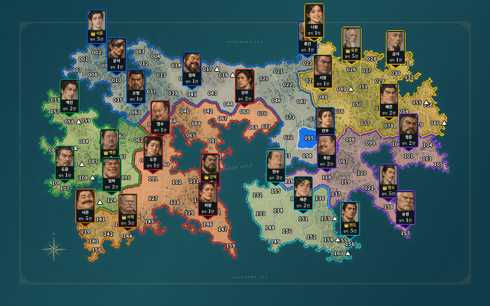
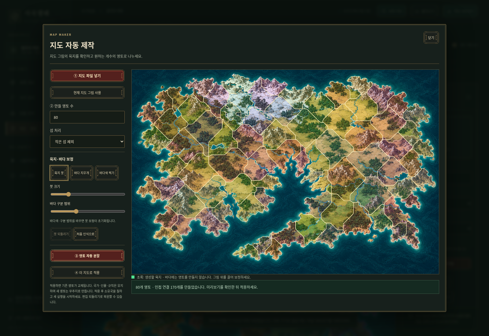
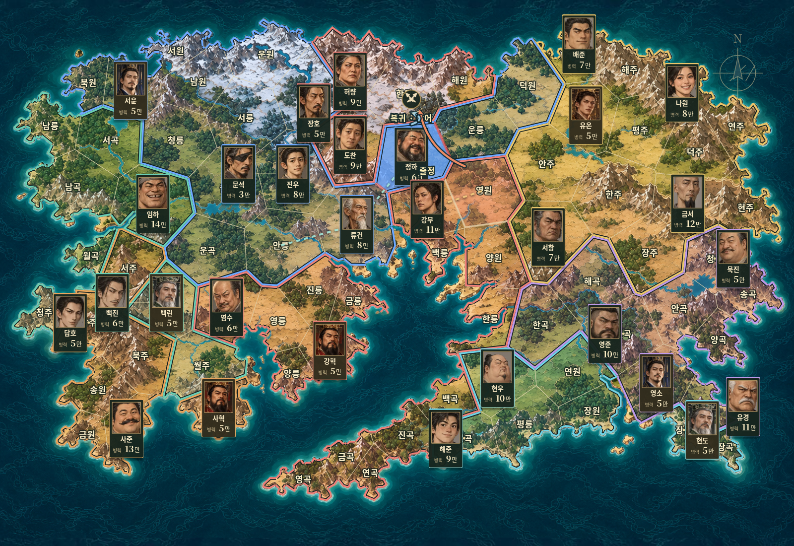
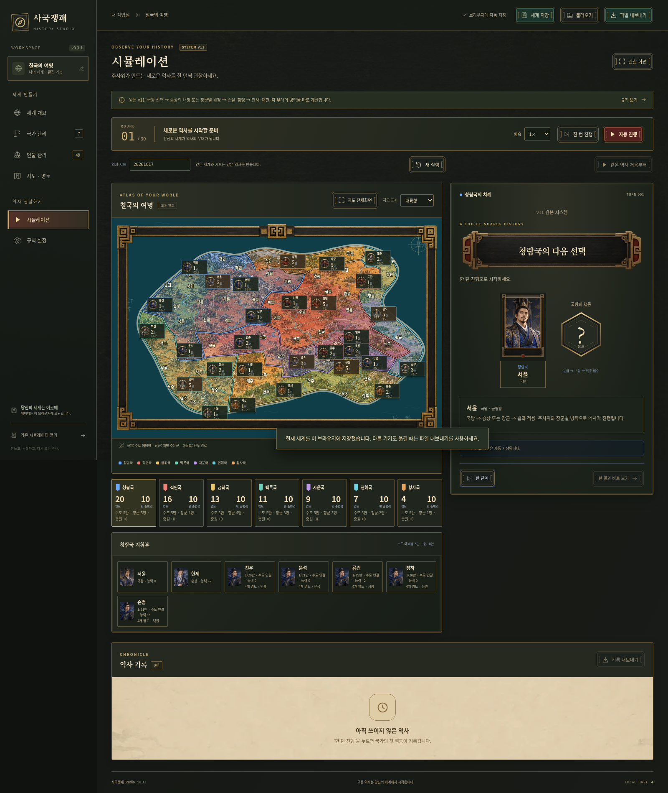
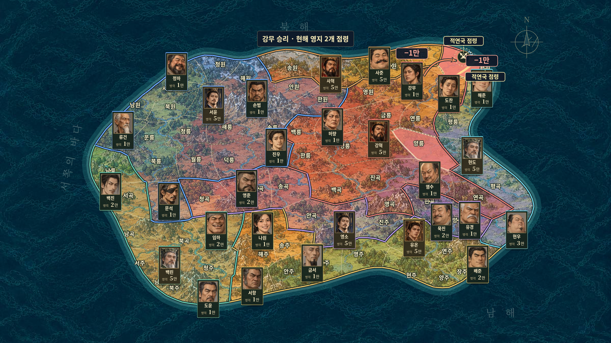

# 사국쟁패 Studio v0.12.0 · 첨부 SVG 160영토 지도와 규모 조정

사용자가 국가·인물·영토·규칙을 편집하고 자동 역사를 관찰하는 프로그램입니다. 첨부 HTML·룰북 v11의 장군별 부대·주둔·내정·후임 체계를 기반으로, **사용자가 승인한 D30 점수 가산 전투**를 새 세계에 적용했습니다. 이전 저장 경기는 당시 D10/D30 규칙으로 이어집니다.



## 설치 없이 실행

**[바로 플레이할 HTML 파일 다운로드](https://github.com/doododoo123-create/-/raw/refs/tags/v0.12.0/%EC%82%AC%EA%B5%AD%EC%9F%81%ED%8C%A8%20Studio.html)**

링크를 우클릭해 **다른 이름으로 링크 저장**을 선택한 뒤, 받은 HTML을 Chrome 또는 Edge로 열면 됩니다. ZIP 압축을 풀 필요가 없습니다. 앞으로도 수정본은 단일 HTML을 별도로 제공합니다.

소스코드도 함께 받으려면 다음 ZIP 방법을 사용하세요.

1. GitHub의 **Code → Download ZIP**으로 받습니다.
2. ZIP 압축을 풉니다.
3. 폴더 안의 **`사국쟁패 Studio.html`**을 Chrome 또는 Edge로 엽니다.
4. **시뮬레이션 → 한 턴 진행**을 누릅니다.

`index.html`은 개발용입니다. 일반 사용자는 `사국쟁패 Studio.html`을 여세요. 실행에 계정·외부 서비스·인터넷·Node 설치가 필요하지 않습니다. 이 클라우드에서는 HTTP로 받은 단일 HTML의 오프라인 동작을 검증했습니다. 실제 Windows에서 파일을 더블클릭하는 검증은 수행하지 않았습니다.

## 이번 수정: 첨부 지도와 160영토 패치

- **지도:** 첨부 continent_160.svg 및 HTML의 동일한160개 경계·357개 육지 인접 연결·지형을 사용합니다. 산악21곳은 기존 수비+8입니다. 삼림·구릉·초원 등은 그림을 보존하되 추가 전투 보정을 만들지 않았습니다. 원본 벡터 삽화와 바다가 한 이미지로 확대·이동하며 외부 요청이 없습니다.
- **규모:** 장군당 담당 영토 **8개**, 국가 충원 상한 **영토당5만**, 보급으로 연결된 영토 **2개당1만 생산**입니다. 홀수 잔여 영토는 내림하며 고립 보급권은 따로 계산합니다. 기본 예제는 기존 국가·인물을 유지하고 연결된 국가 영토를 재배정했으며 초기 장군22명, 기본 생산78만/라운드로80영토 예제와 비슷한 규모입니다. 정책·초기 총병력·개인 지휘한도7/25만·승수 성장·손실률은 유지합니다.
- **점령:** 1~9점 차1개,10~19점 차2개,20점 이상3개까지입니다. 공격1회 기준이며 모든 수비대를 이겨야 하고 추가 점령은 적 지휘관이 없는 연결 영토에 한정합니다. 손실 등급10/20/40과는 독립입니다.
- **이동:** 실제1.5칸을 기존1칸으로 환산합니다. 출정 확률은 환산 거리를 올림하고 피로는 실제6칸마다−2, 구원 범위는 실제4칸입니다. 경로 자체는 실제 육지 인접 관계를 사용하며 바다 연결을 추가하지 않습니다.
- **소국 재기:** 영토1칸인 국가의 수도 최소 예비병은2만으로 줄여 병력 상한5만 안에서 장군에게 병력을 줄 수 있습니다. 영토를 되찾아 목표 예비병이5만으로 늘어도 기존 병력을 강제로 빼앗지 않고 이후 생산으로 채웁니다.
- **편집·보존:** 국가·인물·영토 이름/소유권·산악·표시점·인접 관계 편집과 저장/불러오기를 유지합니다. 원본80영토 예제와 기존 진행 경기는 그대로 보존합니다. 새 세계 만들기에서160영토·기존80영토·원본v11을 선택할 수 있습니다.

새로 연 작업 공간은160영토 예제로 시작합니다. **이전 세계가 열리면 지도 · 영토 → 첨부160영토 지도 적용 → 시뮬레이션 → 새 실행 → 새 실행 준비**를 누르세요. 지도 적용은 초기 영토와 소유권을 교체하고 국가·인물을 보존하며 편집 되돌리기로 복구할 수 있습니다. 실행 중 경기는 새 실행 전까지 바꾸지 않습니다. 규칙 화면의 **160영토용 규칙 적용**은 지도 경계는 바꾸지 않고 규모·점령 설정만 적용합니다.

## 유지되는 기능: 전투 규칙과 지도 판정창 (80영토 기본 설정)

- **손실률:** 최종 점수 차 1~9 / 10~19 / 20~39 / 40 이상에 승자 **15 / 10 / 8 / 5%**, 패자 **20 / 30 / 40 / 50%**를 적용합니다. 각자 전투 시작 병력 기준이며 만 단위로 반올림합니다. 무승부는 양측 각각15%입니다.
- **점령:** 위 네 등급에서 최대 **1 / 1 / 2 / 3개**입니다. 기존 순차 방어와 추가 영토의 지휘관 유무·연결 제한을 유지합니다.
- **지휘한도:** 기본 **7만**, 국가·개인 특성과 승상 보급을 합쳐 **최대25만**입니다. 누적 **3·6·9승마다 +1만, 총+3만**까지 증가합니다. 승리당 전투 점수+1(최대+9)과 별 표시는 그대로이며, 한도 증가가 병력을 생성하지 않습니다.
- **수도 복귀 지휘관:** 예비병에 여유가 있으면 병력0의 지역 없는 생존 지휘관에게 우선1만을 배분합니다. 자국 육지 경로가 있는 전선으로 출정할 수 있고, 지휘 구역이 늘어나면 새 후보보다 생존 지휘관을 먼저 재배치합니다. 구역당 최대4영토와 국가 충원 상한을 유지합니다.
- **일상 복귀:** 왕이 **내정을 선택한 턴만** 담당 주둔지로 복귀합니다. 출정 거부·자동 점령만 있었던 전쟁 턴은 일상 복귀 대상이 아닙니다. 영토 상실 후 퇴각은 별도입니다.
- **선택 연출:** 왕의 내정/전쟁·공격 국가·승상 정책을 항목이 돌아가다 멈추는 파칭코식으로 표시합니다. 내부 선택 확률과 난수는 그대로이며 정책 실행·전투·전사 판정의 주사위는 유지합니다.
- **출정 거부:** 내부 D100은 지도에 표시하지 않습니다. 거부한 경우에만 얼굴·이름·병력과 붉은 **출정 거부**가 있는 별도 창을 보여줍니다.
- **녹화 구도:** 전장을 화면 중앙보다 아래에 두고 그 위에 작은 판정창을 배치합니다. 초상화를 확대하고 이름 아래 병력과 이름 옆 전적 별을 표시합니다. 공격·방어 화살표와 화살촉은 각 국가색, 전투 아이콘은 밝은 선과 검정 외곽선입니다. 모든 주사위의 숫자와 D표기를 떨어뜨렸습니다.
- **바다:** 육지와 같은1536×1024 해상도의 새 바다를 내장하고 과도한3배 확대를 제거했습니다. 반전 반복으로 이음새를 없애며 육지와 같은 지도 카메라를 사용합니다.

기존 경기를 덮어쓰지 않습니다. 새 규칙 적용은 **규칙 설정 → 새 D30 기본값 적용 → 시뮬레이션 → 새 실행**입니다. 아래 이전 기능도 유지됩니다.

## 유지되는 기능: 생존 지휘관과 지도 표시

- **바다 통일:** 관찰 지도에서 배경 그림의 육지만 영토 외곽 안에 표시하고, 안팎의 바다는 하나의 연속된 배경으로 표시합니다. 사각 그림 경계가 보이지 않고 확대·이동도 함께 적용됩니다. 편집 화면에서는 원본 배경 전체를 보며, 원본 이미지·해상도·인접 관계는 보존합니다.
- **생존 지휘관 복귀:** 주둔지를 잃어도 육지 경로에 관계없이 남은 본인 담당 영지로 복귀합니다. 담당 영지가 없으면 수도 인근의 자국 영토에 배치합니다. 영토 수 감소만으로 생존 지휘관을 퇴임시키지 않고 **카드·잔여 병력·전적을 유지**합니다. 경로가 없는 배치는 지도에서 도착 위치로 나타나며 적 땅을 통과하는 이동 경로를 그리지 않습니다. 국가 멸망 판정은 유지합니다.
- **카드 포개기:** 옆 간격을9px에서 **24px**로 넓히고 여러 장도 차례로 옆면이 보이도록 합니다. 클릭 넘기기와 묶음 앞 핀의 이름 위 고정은 유지합니다.
- **왕 표시:** 추가 금색 외곽선을 제거하고 **국가색 테두리·금색 이름·👑**으로 구분합니다.
- **병력 보정 완화:** **1/1.5/2/3/4/5/7/10/15/20배 이상 → +0/+1/+3/+5/+7/+9/+12/+15/+18/+20점**. 실제 교전 부대의 비율에서 한 구간만 적용합니다. 2배 차이는 기존+16에서+3으로,20배 이상은+28에서+20으로 줄었습니다. 장군·전적·산악·피로 보정은 별도로 적용합니다.
- **사망:** 카드가 선명한 빨간색으로 점멸하고 위에 빨간 **사망**을 표시한 뒤 사라집니다.
- **임관:** 새 지휘관 신설·후임 부임 시 카드가 금색으로 점멸하며 위에 초록 **임관**을 표시합니다. 두 연출 모두 배속·일시정지·과거 역사 재생에서 동일하게 동작합니다.

기존 저장 경기는 당시 규칙으로 계속합니다. 새 병력 보정·복귀 규칙을 적용하려면 **규칙 설정 → 새 D30 기본값 적용 → 시뮬레이션 → 새 실행**을 누르세요. 해당 규칙 화면에서 복귀 방식을 직접 선택할 수도 있습니다.

## 유지되는 기능: 순차 방어·충원 상한·연속 재생

- **순차 방어:** 공격받은 영토에 실제로 있는 아군 지휘관들이 먼저, 복귀 가능한 담당 지휘관이 다음으로 방어합니다. 담당자가 막혔으면 기존 3칸 구원군 규칙을 확인합니다. 같은 지휘관은 중복 출전하지 않습니다. 공격자는 손실을 이어받으며, 수비대 중 한 명이라도 이기거나 비기면 영토를 지킵니다. 병력 0인 지휘관은 전투 판정을 생략합니다.
- **이동 피로·퇴각:** 실제 이동 4칸마다 최종 점수 **−2**입니다. 출정·복귀·구원에 적용하며 한 공격에서 수비대가 바뀌어도 이동 피로를 중복 누적하지 않습니다. 주둔지를 잃은 생존자는 경로와 관계없이 본인 담당 영지로 복귀하고, 담당 영지가 없으면 수도 인근에 배치합니다. 왕이 내정을 선택한 자국 턴에는 돌아갈 수 있는 담당 주둔지로 복귀합니다.
- **국가 충원 상한:** **영토 수 ×10만**, 수도 예비병과 모든 장군을 합산합니다. 모병·라운드 생산은 남은 여유만 채우며 초과분을 적립하지 않습니다. 영토를 잃어 상한을 넘더라도 기존 병력은 유지하고 신규 충원만 멈춥니다. 규칙에서 영토당 상한을 바꿀 수 있습니다.
- **승상 보급 정책:** 성공 1회에 모든 장군의 지휘한도를 같은 값으로 **+1~3만** 올립니다. 기존 예비병만 재배분하므로 정책 자체가 총병력을 만들지 않습니다.
- **전선과 추가 점령:** 국왕은 직접 국경이 맞닿은 나라 중에서 상대를 고릅니다. 장군은 가까운 전선의 오목한 빈틈·작은 적 고립지를 우선하고 먼 이동·얇은 돌출·새 작은 고립지 생성을 피하도록 목표를 고릅니다. 바다로 보급 가능한 영토를 단순 고립지로 보지 않습니다. **최대 3개 점령은 유지**하되 추가 영토에 생존 적 지휘관이 있으면 병력 0이라도 자동 점령하지 않으며, 막힌 영토를 건너뛰지 않습니다. 국경 모양을 강제로 바꾸거나 병합하지는 않습니다.
- **지도 카드:** 같은 영토의 카드를 `ㅁ]]`처럼 포개고 클릭하면 앞 카드를 바꿉니다. 전투 중인 지휘관은 앞으로 나옵니다. 묶음 핀 끝은 영토 이름 위에 고정합니다. 중앙 공격·수비 초상화의 바깥 테두리에 국가색을 선명하게 표시합니다. 왕의 금색 이름·왕관과 승패·사망 효과를 표시합니다.
- **역사 연속 재생:** 하단 기록을 클릭하면 선택 턴부터 **마지막 완료된 기록까지** 이어집니다. 정지·재개·**8배속**을 지원하고 마지막에는 멈춥니다. 현재 경기와 자동 저장을 바꾸거나 새 미래 턴을 만들지 않습니다. **현재로 돌아가기**로 원래 정지 지점에 돌아옵니다.

기존 저장 경기는 이전 규칙을 유지합니다. 새 기능을 적용하려면 **규칙 설정 → 새 D30 기본값 적용 → 시뮬레이션 → 새 실행**을 누르세요. 편집한 국가·인물·지도는 그대로 사용합니다.

## 유지되는 기능: D30 전투와 역사 재생

- **첨부 이미지:** 주사위 1~60의 SVG와 왕 10명·승상 10명의 초상화를 적용했습니다. 인물 관리에서 직접 고를 수 있고 장수 50종도 유지합니다. 파일 한 장에 모두 내장되어 인터넷 없이 표시됩니다.
- **새 전투:** `D30 + 병력 차이 + 장군 능력 + 전적 + 방어 지형 − 이동 피로`. 승률 배수나 기적 판정을 쓰지 않습니다. 병력은 실제 교전하는 두 부대만 비교합니다. 1/1.5/2/3/4/5/7/10/15/20배 이상이면 많은 쪽에 각각 +0/+1/+3/+5/+7/+9/+12/+15/+18/+20입니다. 다른 조건이 같을 때 1만 대 30만도 주사위와 장군 보정에 따라 역전할 수 있습니다.
- **성장·산악:** 실전 공격/수비 승리마다 +1점, 최대 +9점. 3/6/9승부터 이름 옆 ★/★★/★★★를 표시합니다. 후임은 0승부터 시작합니다. 산악은 수비 +8이며 지도에서 지정합니다. 장군 능력은 −4~+4입니다.
- **점령·손실:** 한 번에 최대 3영토 점령을 유지합니다. 점수 차 1~19/20~39/40 이상이면 최대 1/2/3개입니다. 손실 등급은 1~9/10~19/20~39/40 이상으로 나누며 각자 시작 병력에서 계산해 만 단위로 반올림합니다. 자세한 표는 [현재 규칙](docs/rules-v0.1.md)을 참고하세요. 규칙 화면에서 눈금·보정 구간·산악·성장·점령 기준·손실을 조절할 수 있습니다.
- **역사 다시 보기:** 시뮬레이션 하단의 기록을 클릭하면 그 턴부터 마지막 완료 기록까지 지도·주사위·병력·영토·출정/복귀를 재생합니다. 오래된 기록도 **이전 기록**으로 찾을 수 있습니다. **현재로 돌아가기**로 현재 경기의 정지 지점에 돌아옵니다. 새로고침 후에도 재생되며 현재 경기를 덮어쓰지 않습니다.
- **지도 이동·추적:** 방향키로 이동하고 Shift를 함께 누르면 빠르게 이동합니다. 사건 자동 추적은 사건 위치로 부드럽게 이동하며 확대율을 유지합니다. 수동 이동은 다음 사건까지 유지됩니다. 일반 시뮬레이션의 **사건 자동 추적**을 끄면 자동 이동하지 않습니다.
- **지도 표시:** 국가 기본색을 선명한 원색으로 바꾸고 지도 글자를 흰색·검정 외곽선으로 정리했습니다. 세로형 장군 카드의 핀 끝이 해당 영토 이름 바로 위를 가리킵니다. 카드에는 얼굴·이름·병력과 전적 별만 표시합니다. 전체화면의 고정 패널은 추가하지 않았습니다.
- **위치 편집:** 지도에서 영토를 고른 뒤 **영토 기준점 / 이름 위치 / 이동 경로점 / 전투 위치**를 선택하고 육지 안을 클릭하거나 표시점을 끕니다. 각 위치를 독립적으로 저장하고 초기화·되돌리기 할 수 있습니다. 표시점을 옮겨도 계산용 중심과 인접 관계는 바뀌지 않습니다.

기존 세계에서 새 전투로 바꾸려면 **규칙 설정 → 새 D30 기본값 적용 → 시뮬레이션 → 새 실행**을 사용하세요. 진행하던 저장 경기는 자동으로 규칙을 바꾸지 않습니다. 원본 v11 지도·규칙도 계속 선택할 수 있습니다.

## 유지되는 기능: 선명한 지도와 국경·보급

- 기본 그림은 기존 1200×800 압축본을 **1536×1024 원본 해상도와 높은 품질**로 교체했습니다. 해안과 영토 위치는 그대로입니다. 새 지도는 **최대 3840×2560(4K)**까지 보존하며 저장·불러오기·자동 제작에서 다시 1200픽셀로 줄이지 않습니다. 확대 한도에서는 원본 그림 자체의 해상도 한계가 있습니다.
- 국가끼리 맞닿는 국경에 **각 나라의 색을 자기 영토 안쪽에 나란히** 표시합니다. 같은 국가의 내부 경계는 국경선으로 표시하지 않습니다.
- **해상 보급:** 자국 육지와 같은 바다를 통해 수도로 이어지는 해안 영토·섬은 고립되지 않습니다. 연결 지역은 수도의 예비병·추가 충원·라운드 생산을 함께 배분받습니다. 적국 영토로 둘러싸여 자국 육지·바다 양쪽 경로가 끊긴 내륙 지역은 고립됩니다. 닫힌 내륙 호수는 바다로 취급하지 않습니다.
- **규칙 → 바다를 통한 보급 연결**에서 켜고 끕니다. 새 참고 대륙과 새 세계에서는 켜집니다. 원본 v11 예제와 **원본 v11 기본값 복원**은 원본 대조용으로 꺼집니다. 새 설정 없는 이전 세계 파일에는 켜지만, 이전 버전에서 진행하던 저장 경기는 당시의 육지 보급 규칙을 유지합니다. 편집 세계에서 켠 후 **새 실행**을 누르면 새 규칙으로 시작합니다.
- 해상 보급은 공격 인접 관계·장군 출정/복귀 경로를 추가하지 않습니다. 보급 자체는 전투 주사위·점수·손실 공식을 바꾸지 않으며, 보급량 변화에 따른 이후 역사는 달라질 수 있습니다.

## 지도 파일을 넣어 자동 제작하기

**지도 · 영토 → 지도 자동 제작**을 누르세요. 인터넷·계정·AI 사용료 없이 브라우저 안에서 처리합니다.

1. **지도 파일 넣기**로 PNG·JPG·WebP 파일(32MB 이하)을 선택합니다. 기본 예제는 **현재 지도 그림 사용**으로 시작할 수도 있습니다.
2. 초록색으로 표시된 육지를 확인합니다. 잘못 잡히면 **육지 붓 / 바다 지우개**로 끌어 보정하거나 **바다색 찍기**로 바다를 클릭합니다. 바다색·구분 범위를 바꾸면 붓 작업은 초기화됩니다. 붓 되돌리기를 제공합니다.
3. 만들 영토 수 **1~480개**와 섬 처리를 선택합니다. **작은 섬 제외 / 모든 섬 포함 / 가장 큰 대륙만**을 지원합니다. 서로 떨어진 육지 덩어리보다 적은 영토 수를 지정하면 선택을 고치도록 안내합니다.
4. **영토 자동 분할**로 미리 봅니다. 각 영토는 연결된 육지로 만들고 내부 호수·바다는 경계에서 제외합니다. 공유 경계로 실제 인접 연결을 계산하며 바다 건너편과 자동 연결하지 않습니다.
5. **이 지도로 적용**을 누르면 기존 영토를 교체합니다. 국가·인물·규칙은 유지하고 새 영토 이름은 ‘영토 1…’, 소유국은 **무주지**로 시작합니다. 적용 전에는 기존 세계가 바뀌지 않고, 적용 후에는 지도 편집 되돌리기로 복원할 수 있습니다.
6. **소유권 칠하기**로 국가를 배정하고 필요한 이름·인접 관계를 수정한 뒤 **새 실행**을 시작합니다. 파일 내보내기에 배경·영토·연결이 함께 저장됩니다.



색 구분이 불분명한 지도에는 보정이 필요할 수 있습니다. 이 기능은 육지를 원하는 개수의 새 영토로 나눕니다. 그림에 이미 그려진 국경·국가 이름을 그대로 복원하거나 산맥·강을 판단해 경계를 만드는 기능은 후속 범위입니다. 자동 분할은 지정한 개수를 맞추며 모든 영토의 면적을 같게 보장하지는 않습니다.

## 지도 확대·축소와 이동

- **세계 개요 / 시뮬레이션 / 지도 편집:** `＋`, `−`, **전체 보기**와 마우스 휠. 범위는 **50~500%**이며 마우스 위치를 기준으로 확대합니다.
- **이동:** 우클릭 또는 가운데 버튼을 누른 채 끕니다. 일반 지도에서는 빈 지도를 왼쪽으로 끌 수도 있습니다. 편집 화면은 **지도 이동**을 켜면 왼쪽 드래그를 사용할 수 있습니다.
- **지도 전체화면:** 휠로 확대·축소, 우클릭 드래그로 이동, **＋ / − / 0**으로 확대·축소·원위치. 고정 조작판을 추가하지 않았습니다. 배율은 유지하며 사건 자동 추적을 끄면 보는 위치도 유지합니다. 방향키와 Shift 이동도 사용할 수 있습니다.
- 지도를 덮던 장식 프레임을 모든 지도 화면에서 제거했습니다. 확대·이동은 화면만 바꾸며 영토 좌표·이름·소유권·전투 난수를 바꾸지 않습니다.

## 이번 수정: 자유 대륙과 출정·복귀

- **참고 그림을 바탕으로 새 대륙:** 큰 남쪽 만, 두 반도, 해협과 구불구불한 해안을 갖춘 삽화 지도와 짙은 청록색 파도 바다입니다. 원본 사진의 픽셀 복사본은 아니며 참고하여 제작한 새 삽화입니다.
- **격자 제한 해제:** 자유 지도는 영토 수·위치·경계를 행·열과 독립적으로 저장합니다. **＋ 영토 그리기**, **영토 삭제**, **영토 통째로 이동**을 사용할 수 있습니다. 영토는 1~480개입니다.
- **실제 연결 편집:** 새 대륙은 맞닿은 경계로 연결했습니다. **맞닿은 경계로 연결**로 다시 계산하거나 **인접 관계**에서 해상 연결 등을 직접 지정합니다. 모양을 옮기거나 다시 그린 뒤에는 이 연결도 확인하세요.
- **지휘관 출정:** 공격 전에 카드가 연결된 자국 영토를 따라 전선 근처의 임시 주둔지로 이동합니다. 담당 지역을 공격받으면 방어 장군이 원래 주둔지로 복귀합니다. 이동 중에만 짧게 ‘출정’·‘복귀 · 방어’와 경로를 표시합니다.
- **이전 규칙의 판정 유지:** fieldCommand를 끈 이전 실행의 임시 주둔은 화면 연출입니다. 실제 담당 구역·수도 연결·보급·전투 수치와 난수를 변경하지 않습니다. 단절되어 자국 경로가 없으면 적 영토를 가로질러 이동하지 않습니다. 같은 역사에서는 같은 이동이 재현되고 완료 턴 저장 후에도 임시 위치를 복원합니다.
- 장수 초상화 50종, 작은 세로 카드, 화면에서 후임 접미사 숨김, 중앙 공격/수비 주사위와 실제 병력 변화 표시를 유지합니다.



기존 저장 세계와 경기는 그대로 엽니다. 기존 **80개 영토 세계**에서 **지도 · 영토 → 참고 대륙 적용**을 누르면 국가·인물·영토 이름·규칙을 보존하면서 지도 배치와 연결을 바꿉니다. 이 작업은 편집 되돌리기로 복구할 수 있습니다. 영토 수가 다른 세계는 **새 세계 만들기 → 참고 그림의 자유 대륙**에서 새 예제를 열거나 직접 그립니다. 진행 중 경기에는 **새 실행**부터 반영됩니다.

## 칠목과 청동 UI

제공한 `사국쟁패_UI이미지_77종.zip`의 **먹빛 바탕·청동 프레임·주홍/옥색 버튼**을 적용했습니다. 지도 프레임, 인물 초상 프레임, 명령 현판과 전투 배너, 국가 깃발·장군 표식, 종이 바탕 기록과 아이콘을 사용합니다. 작은 버튼은 모서리를 보존하고 기본·호버·눌림·비활성 상태를 구분합니다.

이름·병력·주사위는 실제 텍스트입니다. 보정 후 10 초과 숫자와 눈금이 높아질수록 붉어지는 효과를 유지합니다. 지도 전체화면은 상시 장식 프레임·우측 패널 없이 지도만 표시하고 판정 중에만 중앙 인물·주사위를 보여줍니다. 기존 편집 세계·저장·v11 계산은 그대로 사용합니다.



## 지도 그림과 경계 편집

**지도 · 영토**에서 산맥·숲이 보이는 대륙 위에 직접 편집합니다. 새 기본 세계는 참고 그림의 해안 형태를 적용한 자유 지도입니다. 새 세계에서 원본 v11 지도와 기존 격자를 선택할 수도 있습니다. 원본/격자 지도는 ‘격자 제한 해제’로 기존 영토와 연결을 유지하면서 자유 지도로 전환할 수 있습니다.

1. **배경 이미지 불러오기**로 PNG·JPEG·WebP 지도를 선택합니다. 그림은 최대 3840×2560 해상도로 비율을 유지해 저장합니다. 편집 좌표는 1200×800을 사용하므로 기존 경계와 위치는 유지합니다. 그림에서 국경을 자동으로 추출하지는 않습니다.
2. 영토를 선택한 뒤 **경계 꼭짓점 이동**으로 점을 끌거나 **경계 다시 그리기**로 외곽을 차례대로 클릭합니다. **경계 적용**을 눌러 저장합니다. 교차하는 경계는 적용하지 않으며 기존 데이터를 지킵니다. 꼭짓점 3~2048개를 사용합니다.
3. 같은 꼭짓점을 공유하는 기존 영토는 함께 이동합니다. 새로 그리는 영토끼리의 겹침·빈틈은 사용자가 확인해야 합니다. **편집 되돌리기**는 최근 12회 지도 편집을 복원합니다. 국가·인물 등 다른 정보를 수정하면 되돌리기 기록을 새로 시작합니다. 작성 중 Esc는 경계 작업을 취소합니다.
4. **영토 기준점 / 이름 위치 / 이동 경로점 / 전투 위치**로 영토 안의 표시 위치를 각각 옮기고, 오른쪽에서 이름·소유 국가를 바꿉니다. **소유권 칠하기**로 여러 영토를 클릭해 배정할 수 있습니다.
5. **인접 관계**에서는 선택한 영토와 연결할 다른 영토를 클릭합니다. 노란 영토는 연결된 영토이며 다시 클릭하면 연결을 끊습니다. 연결은 양방향이고 바다를 건너는 연결도 지정할 수 있습니다. 공격·육지 연결은 이 연결 목록을 사용하고, 해상 보급을 켜면 바다 경로를 보급에 추가합니다. 그림의 접촉만으로 연결을 자동 변경하지 않습니다.
6. **국가 색 진하기**, **확대**와 스크롤로 그림과 경계를 확인합니다. 편집한 그림·경계·위치·인접 관계는 **세계 저장 / 파일 내보내기**에 함께 포함됩니다.

새 세계는 **참고 대륙 / 빈 자유 지도 / 기존 격자 / 원본 v11** 중에서 선택합니다. 자유 지도는 클릭해 새 영토를 그리고 개별 삭제·이동할 수 있습니다. 행·열 입력은 기존 격자에서만 사용합니다. 자동 제작에서는 육지 인식·분할을 사용할 수 있으며 직접 그린 영토 간 겹침·빈틈을 자동 정리하지는 않습니다. 편집은 **새 실행**부터 적용하며 진행 중 역사는 보존합니다.

## 지도 화면으로 녹화하기

지도 오른쪽 위의 **지도 전체화면**을 누르세요. 화면에는 지도와 주둔군만 남습니다. 오른쪽 정보 패널, 차례·상태 제목, 하단 국가별 집계와 상시 조작 버튼은 표시하지 않습니다.

판정할 때만 원본 HTML처럼 작은 중앙 창에 **인물 초상·이름·특성·주사위**가 나타납니다. 전투는 **공격 장군＋주사위 VS 수비 장군＋주사위**이며, 공격 점수를 유지한 채 수비 주사위를 굴립니다. 결과를 짧게 읽은 뒤 창이 사라지고 지도에 실제 변화가 반영됩니다.

- 부대별 병력 증가: 초록색 `+3만`. 수도에서 부대로 옮기면 수도 `−5만`, 받은 장군에 `+2만`·`+3만`처럼 실제 배분량을 표시합니다.
- 전투 손실: 해당 공격·수비 부대 위에 빨간색 `−1만` 등을 표시합니다.
- 충원력 강화: `매 라운드 충원 +3만`. 보급 강화: 실제 뽑힌 `지휘한도 +1~3만`과 현역 장군의 한도 증가(원본 v11은 +5만). 즉시 병력이 증가한 것처럼 표시하지 않습니다.
- 점령 영토: 획득한 영토를 밝게 강조하고 국가명을 표시합니다. 전사·후임·수도 이동도 해당 위치에 알립니다.

변화 문구는 잠깐 표시한 뒤 사라지며 수동 진행이 끝나 정지해 있어도 남지 않습니다. 일시정지한 판정은 읽을 수 있도록 유지합니다.

전체화면에서는 다음 단축키를 사용합니다. **배속은 일반 화면에서 설정한 뒤 들어가세요.**

| 키 | 동작 |
|---|---|
| Space | 다음 판정 묶음 |
| Enter | 현재 국가의 남은 한 턴 |
| A | 자동 진행 / 일시정지 |
| S | 현재 턴 결과 바로 보기 |
| Esc | 전체화면 닫기 |

주사위 숫자는 높을수록 붉어지며, 보정 후 10을 넘어도 실제 숫자를 유지합니다. 전체화면 API를 지원하지 않는 브라우저에서는 창을 채우는 동일한 지도 화면으로 열립니다. 녹화는 외부 프로그램으로 이 화면을 잡으면 됩니다.



## 원본 v11 모드의 시스템

- 원본의 7국·80영토 지도, 실제 인접 관계·수도·주둔지, 인물 능력과 성향. 국왕·승상 14명과 후보 포함 장군 35명이며 처음 현역 장군은 22명입니다.
- 국왕 D10 행동 선택, 전쟁 불가 시 재판정, 승상 D10 행동 선택과 별도의 실행 판정.
- 모병 +3, 충원력 강화 +3, 보급 강화로 모든 장군의 한도 +5.
- 수도 예비병과 각 장군 병력 분리, 지휘한도, 수도 연결 충원, 고립 지역의 자체 생산·미배분 소멸.
- 선택한 한 상대국을 장군들이 번호순으로 공격. 실제 주둔지와 연결된 지역 기준 후보 갱신, 단절 지역을 연결할 길목 우선.
- 공격·방어 장군의 D10 + 능력 + 부대 병력 우세. 점수 차에 따른 최대 1/2/3영토 점령, 무방비 영토 자동 점령.
- 전투 시작 병력으로 동시 손실 계산, 패배 후 0만인 장군의 전사 판정, 자기 차례 3턴 대기 후 후임 임명, 구역 재편과 수도 이동.
- 라운드 생산, 멸망·통일·제한 종료와 공동 승리. 원본과 같은 숫자 시드·난수 사용 순서.

원본 예제·원본 v11 규칙에서는 원본과 같은 계산을 사용합니다. 새 기본 예제는 D30 규칙을 사용합니다. 사용자가 초기 병력·지도 소유권·인물·규칙을 바꾸면 그 설정에 따라 새 역사가 만들어집니다. 원본과의 대조 범위는 [검증 결과](docs/validation.md)에 기록했습니다.

## 사용법

- **국가 관리:** 국가 추가·수정·삭제, 초기 총병력·추가 충원·색상·성향·수도·국가 지휘한도 보정.
- **인물 관리:** 추가·수정·삭제, 이름·소속·직책·초상화·장군 능력 −4~+4(원본 모드는 −2/0/+2)·승상 성향·장군 자리와 지휘한도 보정. 장군은 필요한 자리만 현역이고 나머지는 후보입니다.
- **지도 · 영토:** 삽화·내 배경 이미지, 자유형 경계·표시 위치, 이름·소유권·인접 관계, 클릭 칠하기, 확대·되돌리기. 인접 관계를 수정하기 전에는 원본 연결 또는 격자 상하좌우 연결을 사용합니다. 원본에는 무주지 점령 규칙이 없으므로 실행 전 모든 영토를 배정해야 합니다.
- **규칙 설정:** 새 D30/원본 v11 선택, 병력·전적·지형 보정·점령·손실, 내정 확률과 증가량·한도·라운드 제한 편집. 변경은 새 실행에 적용됩니다.
- **시뮬레이션:** 지도 위 국왕은 수도 예비병, 장군은 자신의 주둔군입니다. 국가 카드의 총병력에는 예비병과 모든 부대가 포함됩니다.
- **한 단계 / Space:** 다음 판정 묶음을 보여주고 정지합니다. 한 전투의 공격·방어·결과 반영은 함께 진행합니다.
- **한 턴 진행 / Enter:** 현재 국가의 남은 턴을 진행합니다. **자동 진행**은 국가들을 계속 진행하며 다시 누르면 멈춥니다.
- **배속·턴 결과 바로 보기·관찰 화면:** 녹화에 맞춰 조절합니다. Esc로 관찰 화면을 나옵니다. 녹화는 외부 프로그램을 사용합니다.
- **새 실행:** 편집한 세계로 시작합니다. 시드는 0~4294967295의 숫자입니다. **같은 역사 처음부터**는 현재 실행의 시작 세계와 시드를 사용합니다.

처음 상태로 돌아오려면 `examples/칠국의 여명.world.json`을 불러오세요. 새로운 세계는 **세계 개요 → 새 세계 만들기**에서 만듭니다. 국가 수는 고정하지 않습니다.

## 저장과 이전 버전

- 편집 세계는 브라우저에 자동 저장하며 **파일 내보내기 / 불러오기**로 세계 JSON을 보관합니다.
- 실행은 **완료된 국가 턴**마다 자동 저장합니다. 새로고침 후 같은 영토·부대·난수에서 이어갑니다. 진행 중 연출은 마지막 완료 턴부터 다시 계산합니다.
- **기록 내보내기**는 시작 세계·시드·전체 턴 기록·최종 상태를 역사 JSON으로 보관합니다. 기록 클릭으로 과거 시점을 재생합니다. 외부 역사 파일 가져오기는 후속 기능입니다.
- 같은 브라우저·주소의 저장 공간을 사용합니다. 브라우저 데이터 삭제나 파일 위치 변경에 대비해 중요한 세계·역사는 파일로 보관하세요.
- 이전 Studio 세계 JSON은 이름·소유권 등 편집 내용을 유지하면서 v11 설정으로 전환합니다. 이전 브라우저 세계는 별도 백업 키에 보존합니다. 간소화 엔진의 진행 기록을 v11 경기로 변환하지는 않습니다.
- 첨부 원본 HTML과 룰북은 `docs/reference/`에 원본 그대로 보관했습니다. 원본 게임의 세이브 파일은 Studio 세계 파일과 별도 형식입니다.

## 주요 소스 구성

| 위치 | 역할 |
|---|---|
| `src/engine/retreat-home.js` | 담당 영지 복귀·수도 인근 선택·기록 가능한 재배치 |
| `src/ui/studio-v10.css` | 금색 왕 이름·왕관·빨간 사망·금색 임관과 상태 문구 |
| `src/engine/campaign-combat.js` | 새 순차 방어·영토 점령·전사·퇴각 처리 |
| `src/engine/campaign-logistics.js` | 충원 여유·이동 피로·방어 순서·퇴각 경로 |
| `src/engine/frontier.js` | 가까운 전선·오목한 국경·고립지 정리 우선순위 |
| `src/ui/unit-stack.js`, `studio-v09.css` | 카드 포개기·앞 카드 선택·국가색 강조 |
| `src/engine/field-command.js` | 실제 위치의 자국 경로·거리별 출전·구원 지휘관 선택 |
| `src/ui/unit-outcomes.js`, `studio-v08.css` | 승패/사망 카드 연출의 기본 스타일 |
| `src/model/combat-rules.js`, `src/ui/rules-view.js` | D30 전투 공식·설정과 편집 화면 |
| `src/engine/replay.js` | 과거 턴 복원·판정 대조·재생 캐시 |
| `assets/dice/`, `assets/leaders/`, `scripts/studio-art.mjs` | 주사위 60종·지도자 20종과 단일 HTML 내장 |
| `src/ui/camera-focus.js`, `studio-v07.css` | 사건 위치 추적·마커·새 주사위 표시 |
| `src/model/sea-supply.js` | 영토 경계의 육지·바다와 수도 보급용 해상 연결 계산 |
| `src/ui/map-image.js` | 최대 4K 이미지 저장과 반복 압축 방지 |
| `src/model/map-generation.js` | 바다색 판별·육지 보정 데이터·연결된 영역 분할·경계와 인접 추출 |
| `src/ui/map-generator.js` | 파일 선택·붓·섬 옵션·자동 분할 미리보기·적용 |
| `src/ui/map-camera.js` | 지도 카메라·휠·버튼·드래그·배율 유지 |
| `src/model/free-map.js`, `src/data/reference-world.js`, `reference-map.js` | 자유 영토 추가·삭제·이동, 공유 경계 연결과 참고 대륙 예제 |
| `src/engine/command-movement.js` | 연결된 자국 경로·임시 주둔·방어 복귀를 기록에서 계산 |
| `assets/maps/`, `src/data/reference-art.js` | 새 해안 삽화와 내장 바다 |
| `assets/portraits/`, `scripts/general-portraits.mjs` | 장수 사진 50개와 오프라인 이미지 데이터 생성 |
| `src/ui/unit-layout.js`, `map-refinements.css` | 작은 세로 카드·얼굴 확대·지도 판정 위치 |
| `src/ui/battle-map.js`, `map-ocean.js` | 전투 경로·벡터 표식·해안과 바다 |
| `src/ui/display-names.js` | 후임 이름의 표시용 정리 |
| `assets/ui-kit/`, `src/ui/lacquer-bronze.css` | 제공한 77종 자원과 UI 외형·상태 스타일 |
| `scripts/ui-kit.mjs`, `src/ui/kit-icons.js` | SVG 아이콘을 인라인 경로로 동기화 |
| `src/model/cartography.js` | 선택적인 지도 디자인, 경계·이미지·인접 관계 검증 |
| `src/ui/map-editor.js`, `map-editor-view.js`, `map-editor.css` | 지도 편집 조작·그리기·배경 불러오기·확대·되돌리기 |
| `src/model/cartography-geometry.js`, `src/data/terrain-art.js` | 저장된 경계의 표시 좌표와 오프라인 삽화 자원 |
| `src/model/world.js` | 세계 형식 2, 검증, 이전 세계 변환, 기본 규칙 |
| `src/data/v11-preset.js`, `demo-world.js` | 원본 지도·인물 데이터와 시작 세계 |
| `src/engine/v11-core.js` | 원본 계산 순서와 상태 구조를 보존한 v11 엔진 |
| `src/engine/simulation.js` | 편집 세계를 엔진에 연결, 턴 기록·화면 상태 생성 |
| `src/storage/world-store.js`, `run-store.js` | 세계 파일과 완료 턴 저장·복구 |
| `src/ui/atlas-view.js`, `src/model/map-geometry.js` | 원본/격자 지도, 주둔군·경계·전투 경로 |
| `src/ui/map-stage.js`, `map-stage.css`, `judgment-overlay.js` | 지도 단독 전체화면과 일시적인 중앙 판정 |
| `src/ui/map-effects.js` | 부대·수도·영토의 실제 전후 변화와 강화 표시 |
| `src/ui/die-view.js` | 일반 화면과 중앙 연출이 함께 사용하는 주사위 |
| `src/ui/dice-colors.js` | 눈금·보정 점수에 따른 주사위 색상 |
| `src/ui/playback.js`, `arena-view.js` | 사건 순서별 주사위·전투·결과 표시, 별도 연출 시계 |
| `src/app.js`, `src/ui/*.css` | 편집 화면·조작 연결과 스타일 |
| `tests/reference-helper.js`, `engine.test.js` | 변경하지 않은 HTML을 실행해 새 엔진과 직접 비교 |

[구조](docs/architecture.md) · [현재 규칙](docs/rules-v0.1.md) · [테스트 결과](docs/validation.md) · [개발 원칙](AGENTS.md)

## 개발 실행

Node.js 22 이상에서 실행합니다. 외부 라이브러리 설치는 필요 없습니다.

```sh
npm start        # 터미널에 표시되는 주소로 접속
npm test         # 원본 대조·세계·저장·연출 검사
npm run check    # 구문 검사
npm run release  # UI 자원을 내장해 dist와 루트의 실행 HTML 갱신
```

새 바다·24px 카드·왕관·사망/임관·생존 지휘관 수도 배치 검사: `python tests/studio_v10_smoke.py`. 순차 방어·포갠 카드·국가색·8배속 연속 역사와 충원 상한 검사: `python tests/studio_v09_smoke.py`. 출전·만 단위 손실·전사/승패 카드·바다 카메라 검사: `python tests/studio_v08_smoke.py`. 과거 기록·지도 위치·이미지 화면 검사: `python tests/studio_v07_smoke.py`. 지도 해상도·양쪽 국경·규칙 화면 검사: `python tests/map_quality_smoke.py`. 자동 제작·카메라 검사: `python tests/map_generator_smoke.py`. 자유 지도 화면 검사: `python tests/free_map_smoke.py`. 추가 화면 검사: 서버 실행 후 `python tests/skin_smoke.py`를 실행합니다. Playwright와 Chromium이 필요하며, 단일 HTML의 오프라인 검사는 `STUDIO_TEST_URL`에 dist HTML 주소를 지정하고 `STUDIO_OFFLINE=1`로 실행합니다.

Windows에서는 Node 설치 후 `Studio 실행.cmd`도 사용할 수 있습니다. 주요 변경은 Git 커밋과 버전 태그로 보관합니다.

## 후속 개발

기존 그림의 국경·이름 복원, 산맥·강을 따르는 분할, 영토 간 겹침 자동 정리, 사용자 초상화·국기, 실행 중 관리자 개입, 강제 행동·주사위 지정 화면, 역사 분기·다중 역사 보관함, 자막·녹화용 배치 편집, Windows 설치형 앱은 아직 구현하지 않았습니다. 현재 편집 화면은 시작 세계를 수정하며 진행 중 실행에는 새 실행부터 적용합니다.
