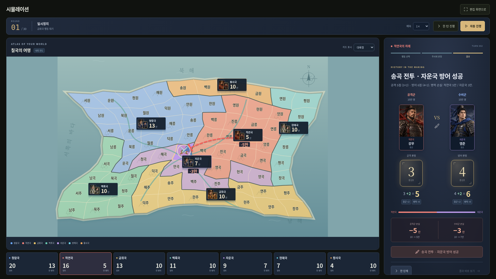

# 사국쟁패 Studio v0.1.1 · 시각화 보강판

내가 만든 세계에서 국가들이 스스로 경쟁하고 역사를 만드는, 브라우저 기반 가상역사 실험실입니다. 세계를 편집하고 자동 시뮬레이션을 돌려 보는 첫 프로토타입에, 원본 HTML의 초상화와 지도·주사위·전투 표현을 더한 버전입니다.



## 가장 쉬운 실행 방법

1. GitHub 저장소 위쪽의 **Code → Download ZIP**을 눌러 내려받고 **압축을 먼저 풀어 주세요.**
2. 폴더 안의 **`사국쟁패 Studio.html`**을 더블클릭해 Chrome 또는 Edge로 여세요.
3. 설치·가입·서버 연결 없이 사용할 수 있습니다. 처음에는 **‘칠국의 여명’** 예제 세계가 열립니다.

소스코드 폴더에서 직접 작업한다면 Node.js 22 이상을 설치하고 아래의 개발 실행 방법을 쓰세요. `npm run build`로 만든 실행본은 `dist/사국쟁패 Studio.html`에 있습니다. HTML 파일 자체를 고치지 말고 `src/`를 수정한 뒤 다시 생성합니다. GitHub ZIP용 루트 실행본까지 갱신하려면 `npm run release`를 사용합니다.

이 클라우드의 관리형 브라우저는 `file://` 주소를 차단하므로 더블클릭 동작은 여기서 직접 검증하지 못했습니다. 같은 단일 HTML을 서버로 연 뒤 네트워크를 끄고 편집·내보내기·시뮬레이션이 동작함은 확인했습니다. Windows와 실제 Edge에서의 실행 검증은 남아 있습니다.

## 처음 해 보기

1. **국가 관리**에서 나라를 추가하거나 이름·색·초기 병력·성향·추가 충원량을 바꾸세요.
2. **인물 관리**에서 국왕·승상·장군을 추가하거나 수정하세요. 국왕과 승상은 국가당 각 1명입니다.
3. **지도 · 영토**에서 영토를 클릭해 이름과 소유국을 바꾸세요. ‘소유권 칠하기’는 국가를 고른 뒤 클릭하는 영토를 바로 배정합니다.
4. **규칙 설정**에서 주사위·내정 확률·충원·전투 손실·라운드 제한을 조정하세요.
5. **시뮬레이션**에서 ‘한 턴 진행’ 또는 ‘자동 진행’을 누르세요. 영토를 가진 국가가 2개 이상 필요합니다.
6. 배속을 바꾸거나 일시정지할 수 있습니다. ‘관찰 화면’은 메뉴와 편집 안내를 숨기고 16:9 화면 녹화를 돕습니다. 1920×1080과 1366×768에서 화면 맞춤을 검증했습니다. `Esc`로 돌아옵니다. 영상 녹화는 사용자가 쓰는 외부 프로그램으로 합니다.
7. 오른쪽 판정 화면의 **한 단계**는 눈금·보정·다음 장면을 직접 넘깁니다. **결과 바로 보기**는 현재 턴의 남은 연출만 건너뜁니다. 일시정지하면 굴리던 주사위와 같은 장면에서 이어 볼 수 있습니다.
8. 다른 역사를 만들려면 ‘새 실행’에서 **시드**를 바꾸세요. 같은 시작 세계·규칙·시드·엔진 버전이면 같은 결과가 나옵니다.

빈 세계를 시작하려면 **세계 개요 → 새 세계 만들기**를 누르세요. 국가와 인물이 없는 격자에서 원하는 나라들을 직접 구성합니다. 새 세계 생성·세계 파일 불러오기는 현재 세계와 실행 기록을 교체하므로 먼저 내보내 주세요.

## 저장은 두 가지입니다

- **세계 저장 / 자동 저장:** 국가·인물·영토·규칙을 현재 브라우저에 보관합니다. 새로고침 후 편집 세계가 복구됩니다. 다른 기기·브라우저·실행 주소와 공유되지는 않습니다.
- **파일 내보내기 / 불러오기:** 세계 전체를 `.world.json` 파일로 옮깁니다. 다른 기기로 이동하거나 장기 보관할 때 사용하세요. 브라우저 데이터 삭제·시크릿 모드·HTML 이동 등에 대비해 중요한 세계는 파일로 보관하세요.
- **역사 기록 → 기록 내보내기:** 실행의 시작 세계, 시드, 엔진 버전, 전체 턴 기록, 결과와 최종 상태를 `.history.json`으로 보관합니다. 세계 파일과는 다른 형식입니다. **실행 중인 역사 자체는 자동 저장되지 않으므로 새로고침·새 실행 전에 내보내 주세요.** 기록 파일 가져오기·재생·중간 재개는 후속 기능입니다.

세계 파일에는 실행 기록이 들어가지 않습니다. 저장 실패나 잘못된 파일은 화면에 오류를 표시하며, 잘못된 파일로 세계를 덮어쓰지 않습니다. 원본 HTML·기존 게임 세이브는 Studio 세계 파일과 형식이 달라 직접 가져올 수 없습니다.

## 현재 구현된 기능

- 국가 수를 고정하지 않는 국가 추가·수정·삭제; 초기 병력·추가 충원·색상·기본 성향 편집
- 인물 추가·수정·삭제; 소속·직책·능력 보정·성향, 원본 초상화 12종 선택, 이름 검색·국가/직책 필터
- 격자 지도의 이름·소유권 편집, 무주지, 클릭 칠하기, 영토 이름 표시 전환
- 세계별 지도 크기 지정: 가로 2~24, 세로 2~20; 국가 최대 100, 인물 최대 2,000 (과도한 입력을 막기 위한 안전 제한)
- 브라우저 저장·복구, 검증된 JSON 파일 가져오기·내보내기
- 화면에서 바꾸는 임시 규칙; 시드 난수; 국가별 자동 내정·전쟁; 병력 생산·손실·점령·멸망·승리 판정
- 한 턴 진행, 자동 진행·일시정지, 0.5/1/2/4배속, 국가별 병력·영토, 주사위와 계산 결과를 담은 턴 기록
- 대륙형 지도와 격자형 표시 전환, 해안선·산·강 배경, 지도 위 국가 병력과 국왕·장군 얼굴 카드
- 국왕·승상 초상화와 주사위 회전, 눈금 확정과 능력 보정, 장군 대결 화면
- 공격·방어 경로, 목표 영토 강조, 점령과 병력 변화, 멸망 알림
- 한 단계씩 판정 보기·결과 바로 보기, 일시정지·배속에 연동하는 장면 진행
- 16:9 관찰 화면, 최근 점령 강조, 전체 역사 JSON 내보내기
- 예제: 첨부 원본의 7개 국가·36명 인물·80영토를 격자에 옮긴 ‘칠국의 여명’
- 첨부 원본 HTML·룰북 보존; 사이드바 ‘기존 시뮬레이터 열기’로 원본 플레이 가능

## 임시 규칙과 후속 개발

**기존 HTML의 상세 규칙을 전부 이식한 버전이 아닙니다.** Studio v0.1은 국가별 통합 병력, 국가당 한 번의 내정 또는 전투, 승리 시 1영토 점령을 사용합니다. 정확한 현재 규칙과 원본과의 차이는 [현재 규칙](docs/rules-v0.1.md)에 적었습니다.

다음은 이번 범위에서 구현하지 않았습니다.

- 사용자 지도 이미지, 자유형 영토 경계·수동 인접 관계, 사용자 초상화 업로드·국기 이미지
- 원본의 장군별 부대·담당구역·주둔지·지휘한도·고립 보급·후임 제도·연결 길목·추가 점령
- 실행 중 국가·병력·영토 직접 수정, 다음 행동/주사위/전투 결과 강제 지정
- 과거 시점 복귀·분기, 기록 파일 불러오기·재생, 여러 실행의 앱 내부 보관함
- 더 세밀한 부대 이동·전투 효과, 자막·화면 배치 편집·과거 재생 타임라인
- Windows 설치형 앱, 영상 파일 출력 (녹화는 외부 프로그램 사용)

대륙형 지도는 편집한 격자의 상하좌우 인접 관계를 그대로 그리는 표시 방식입니다. 세계나 국가 배치를 무작위로 생성하지 않습니다. 얼굴 옆 병력 숫자는 국가 전체의 합계이며 실제 장군 부대나 주둔지를 뜻하지 않습니다. 산과 강도 현재는 배경입니다.

당장은 편집한 시작 세계가 진행 중인 실행에 섞이지 않도록 복사본으로 실행합니다. 진행 중 편집한 내용은 **새 실행**부터 반영됩니다. 국왕 능력과 승상·장군 성향은 향후 확장용 데이터이며 현재 판정에는 쓰이지 않습니다.

## 개발 실행 방법

필요 도구: Node.js 22 이상. **외부 라이브러리 설치와 `npm install`은 필요 없습니다.**

```sh
npm start
```

터미널에 표시되는 주소를 브라우저 주소창에 입력하세요. 기본 주소는 `http://localhost:3000`입니다. 종료는 `Ctrl+C`입니다. Windows에서는 Node 설치 후 **`Studio 실행.cmd`**를 실행해도 됩니다. 서버가 뜨기 전에 브라우저가 먼저 열리면 한 번 새로고침하세요.

```sh
npm test       # 엔진·저장·데이터 테스트
npm run check  # JavaScript 구문 검사
npm run build  # dist/에 단일 HTML 생성
npm run release # GitHub ZIP용 루트 실행본도 갱신
```

포트가 사용 중이면 이전 실행 창을 닫으세요. 다른 포트도 가능합니다.

```sh
# macOS / Linux
PORT=3001 npm start
# Windows PowerShell
$env:PORT=3001; npm start
```

기본 서버는 현재 기기의 로컬 주소에서만 듣습니다. 외부 서비스·비밀키·CDN·데이터베이스가 필요하지 않습니다. 클라우드에서는 기존 `/workspace/-` 체크아웃을 그대로 사용하며 별도 worktree를 만들지 않습니다.

## 주요 소스 구성

| 위치 | 담당 |
|---|---|
| `src/model/world.js` | 세계 형식, 검증, 인접 관계, 국가 삭제 |
| `src/data/demo-world.js` | 시작 예제 데이터 |
| `src/engine/random.js` | 같은 결과를 내는 시드 난수 |
| `src/engine/simulation.js` | 화면과 독립적인 턴·전쟁·생산·종료 |
| `src/storage/world-store.js` | 파일 형식, 브라우저 저장, JSON 입출력 |
| `src/app.js` | 화면 전환과 편집·실행 연결 |
| `src/ui/atlas-view.js`, `map-geometry.js` | 인접 관계를 보존하는 대륙 지도, 얼굴·병력 카드와 전투 경로 |
| `src/ui/arena-view.js`, `playback.js` | 주사위·전투 장면, 판정 공개와 일시정지·배속 |
| `src/ui/portraits.js`, `src/data/portraits.js` | 원본 초상화와 인물별 선택 |
| `src/ui/*.css`, `icons.js` | 스타일, 공용 아이콘·문자열 표시 |
| `scripts/` | 서버, 구문 검사, 단일 HTML 만들기 |
| `tests/` | 엔진·저장 자동 테스트, 브라우저 검증 |
| `docs/reference/` | 변경하지 않은 사용자 원본 |

[설계와 확장 지점](docs/architecture.md) · [원본 분석](docs/prototype-analysis.md) · [테스트 결과](docs/validation.md) · [개발 원칙](AGENTS.md)

## 버전 관리

사용자 원본을 보존한 초기 단계와 구현 완료 단계를 Git 커밋으로 보관했습니다. `git log --oneline`으로 확인할 수 있습니다. 앞으로 수정할 때도 관련 테스트 후 커밋을 남깁니다. 사용자 승인을 받은 업로드는 GitHub 커밋 기록으로도 보관합니다. 웹사이트 배포나 환경 게시와는 별도입니다. 실행용 배포 ZIP에는 소스가 포함되지만 `.git`은 포함하지 않습니다.

별도로 만든 배포 ZIP에는 주요 단계의 전체 이력을 담은 `Git-history-v0.1.bundle`도 함께 넣었습니다. GitHub의 Download ZIP에는 이 파일이 없으며, GitHub 자체의 커밋 기록 또는 `git clone`으로 이력을 확인할 수 있습니다. 번들 파일이 있는 경우 개발자가 `git clone Git-history-v0.1.bundle studio`로 커밋 이력을 복원할 수 있습니다.

## 클라우드 환경 재사용

현재 클라우드에서 실행·테스트·빌드를 완료했고 `install_script`와 `start_skill`을 환경 설정 초안에 저장했습니다. 초안 저장만으로 다음 작업에 적용되지는 않습니다. 클라우드에서도 재사용하려면 **환경 설정에서 변경 내용을 검토하고 저장한 뒤 환경을 게시**하세요. 새 클라우드 작업으로 복원하는 검증은 아직 수행하지 않았습니다. 다운로드한 실행본을 사용하는 데는 게시가 필요 없습니다.
