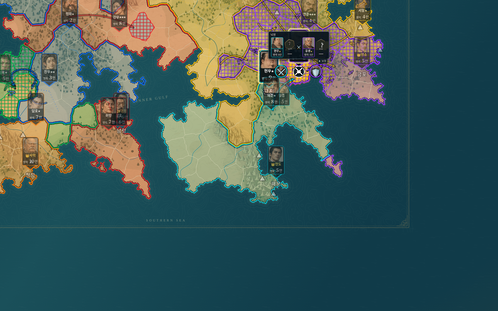
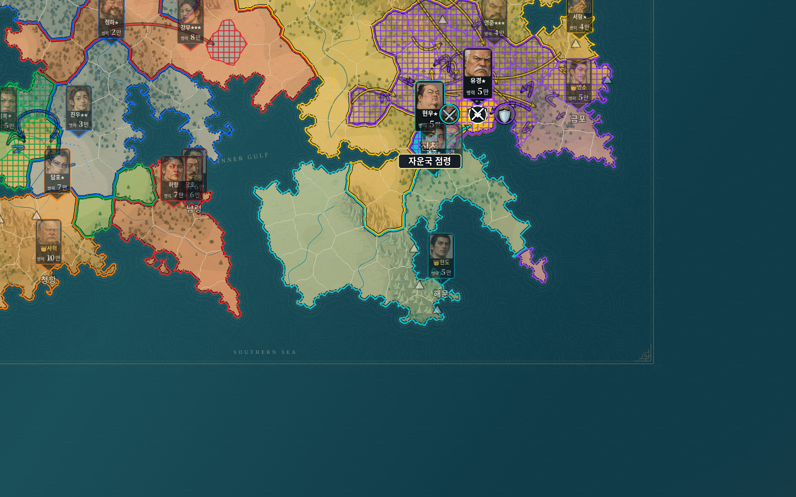
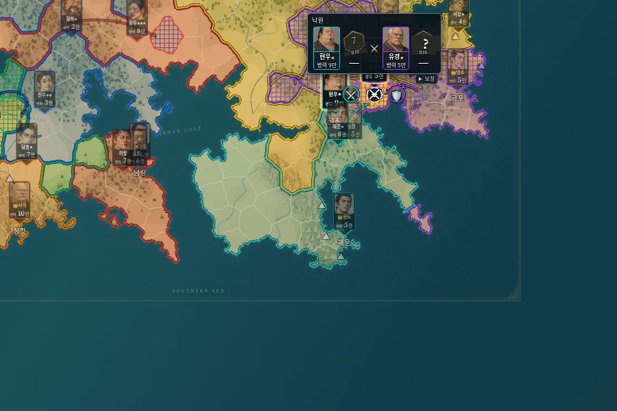
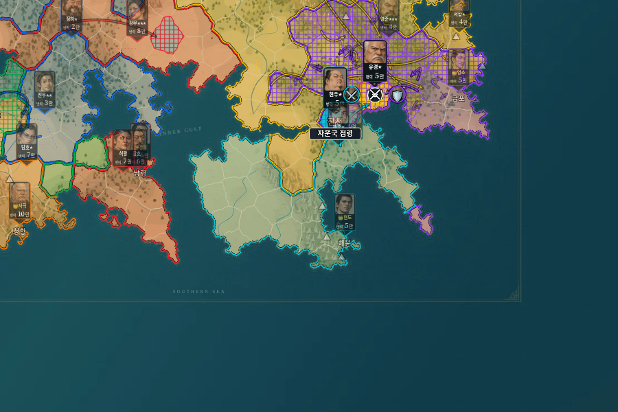

# v0.15.0 한 바퀴 관전·방어 역점령 검증 · 2026-10-22

## 적용 범위

지도 연출은 모든 국가가 한 번씩 행동하는 round 단위로 누적한다. 새 실행 엔진20은 수도 예비병10만 제한과 방어 우세20/40점의 최대1/2개 역점령을 적용한다. 공격 측1~3개 점령, D30 보정, 손실률, 승수 성장, 개인 최대25만은 유지한다. 기존19 이하 실행은 당시 규칙과 병력을 보존한다. 사용자가 거절한 공세 요약판/수복 우선 규칙은 추가하지 않았다.

## 자동 검사

- `npm test`: **194개 통과**, 실패0. 원본 HTML의687턴 대조, 이전 버전 저장, 전투/생산/세계 편집/재생 검사를 포함한다.
- `npm run check`: **115개 JavaScript 구문 검사 통과**.
- 새 `tests/campaign-v15.test.js`의14개 검사는 역점령19/20/39/40 경계, 공격 출발지 우선, 다른 생존 적 지휘관의 차단(병력0 포함), 최대2칸, 마지막 영토 역점령에 따른 통일, 생존자 복귀와 소유권 기록 방향을 확인한다.
- 수도 상한 적용 전에 장군을 보충하고, 개인군25만과 별도로 예비병만10만을 유지하는지 검사한다. 국가 전체 상한·모병·생산 미충원 수량과 초기 미편성 표시, 잘못된 규칙 입력도 검사한다.
- 결과 공개 전 격자/화살표 노출 금지, 영토 단계부터의 실제 획득, 다음 국가까지의 누적, 한 바퀴 생산 경계에서의 정리, 반복 공격 곡선/화살촉 분리와 국가색, 실제 무승부 공유 선분을 확인한다.
- 기존v0.9 규칙 검사에는 수도 무제한/역점령 끄기를 명시하여 당시 규칙을 유지한다. v0.13/v0.14의 전투 문구 검사는 사용자 요청에 맞춰 아이콘 표시로 갱신한다.
- 실제 Git 태그v0.14.0 소스로 생성한30턴 저장을 새 코드로 복구해 다음5턴의 engineState가 완전히 같음을 확인했다.23턴 역사 주사위/영토 변화도 일치한다. 구버전 수도 병력을 삭감하지 않는다.
- `git diff --check` 통과. 지도 원본·경계·초상화·주사위 자산은 변경하지 않았다.

전체194개 검사 뒤 화살촉 간격을 마지막으로 조정했고, 관련14개 검사를 재실행하여 모두 통과했다.

## 두 HTML의 브라우저 검사

`python tests/studio_v15_smoke.py`를 사용해 실제 일반/모바일 단일 HTML을 Chromium에서 실행했다.

1. 160개 영토와 새 규칙 편집값을 확인하고 역점령 기준을 변경·저장한 뒤 복원했다.
2. 실제42턴 경기의41턴에서 역사 재생을 시작했다. 이전 국가의 점령 격자와 화살표가 이미 보이며, 현재 전투의 결과는 확정 전까지 공개되지 않는다.
3. 작은 판정창은196px 기준이며 얼굴·이름·별·병력·실제 주사위/최종 점수와 검·방패를 표시한다. 기존 전투 발생/공격/수비 문구가 없고 상대의 미판정 점수가 숨겨져 있다.
4. 국가 행동 도중 viewBox가 바뀌지 않는지, 결과 적용 후 격자가 해당 국가색으로 표시되는지, 이전 화살표가 남는지 확인했다.
5. 일반1600×1000, 경량900×600 및390×844/844×390에서 창이 화면 안에 들어오고 싸움 아이콘을 가리지 않는지 확인했다.
6. 8배속으로42턴까지 연속 재생해 한 바퀴 끝에서 흔적이 정리되고 최종 소유권이 엔진 결과와 같은지 확인했다. 현재 실행의 localStorage 저장 문자열은 재생 전후 동일했다.
7. 현재 경기 복귀/새 실행/한 턴 건너뛰기 이후 엔진20 저장과 수도10만 상한을 확인했다.
8. 두 HTML을 네트워크 없이 다시 열어160개 영토가 표시됨을 확인했다. JavaScript 예외·외부 요청 실패0건.

배포본 루트 HTML과dist HTML이 바이트 단위로 일치하는 것도 확인했다. 브라우저 검증은 HTTP로 제공한 내장형 단일 HTML 기준이며 실제 Windows 더블클릭/실제 Android·iPhone 기기 검사는 수행하지 않았다. 경량판은 기존 WebP 확대 한계를 유지한다.

## 화면 예시

