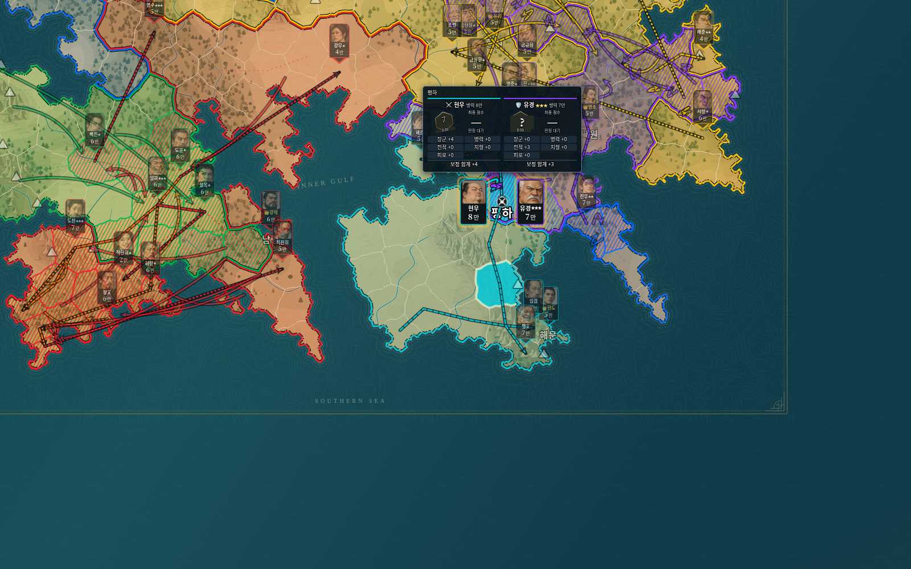
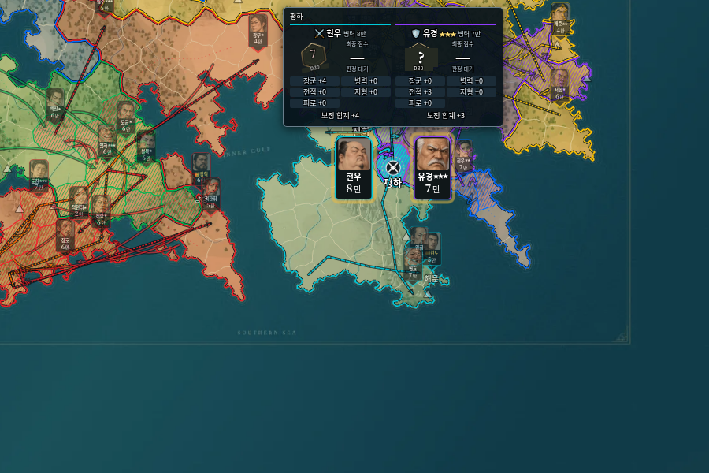
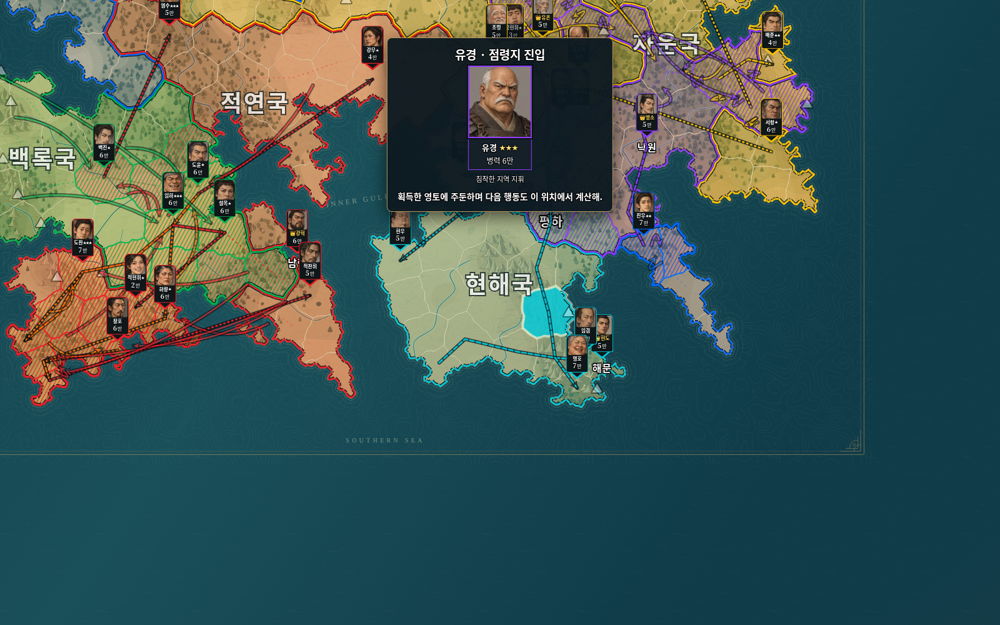

# v0.16.0 지도 카드·전투 배치·점령 후 주둔 검증 · 2026-10-22

## 적용 사항

지도 카드를32×54로 줄이고 축소 시 숨기는 규칙을 제거했다. 화면 너비는24~36px로 유지한다. 전투에는 두 지도 카드만 아이콘 양옆에48px로 표시하며 원형 복제 얼굴은 제거했다. 위쪽 판정창은 약280px이며 모든 보정과 합계를 항상 표시한다. 제자리 수비 화살표는 제거하고 패자의 실제 퇴각·재배치 화살표를 남긴다. 점령 무늬는4단위 간격의 한 방향28도 대각선이다.

새 실행 엔진21은 최종 점령자의 실제 위치를 첫 획득 영토로 전진시킨다. 다수 수비대의 중간 승리에는 전진하지 않는다. 자동 점령과 방어 역점령도 같은 위치 규칙을 사용한다. 지휘관의 원래 담당 주둔지는 별도다.20 이하 실행은 새 occupationAdvance 플래그를false로 고정해 당시 위치·난수·역사를 보존한다.

## 자동 검사

- `npm test`: **204개 통과**, 실패0. 기존 원본 HTML687턴 대조, 이전 저장·세계/지도·전투·생산·재생 검사를 포함한다.
- `npm run check`: **118개 JavaScript 구문 검사 통과**.
- 새 `tests/campaign-v16.test.js`10개는 공격자/역점령 수비자의 진입, 무전투 점령의 승수 불변, 모든 수비대 격파 후에만 전진, 실제 이동 경로와 퇴각 도착지, 제자리 수비 무화살표와 복귀 수비 경로 유지를 검사한다.
- 퇴각 시작 시점부터 경로를 표시하되 이후 점령 이동을 미리 보여주지 않는지 확인했다. 경로 없는 재배치도 실제 from/to를 기록해 별도 점선으로 표시한다.
- 작은 핀의 크기·끝점, 표시 전용 전투 카드의 별도 그룹, 원형 복제 제거,0까지 포함한 모든 보정과 판정 전 최종 점수 숨김, 한 방향 촘촘한 점령선을 확인했다.
- 실제 Git 태그v0.15.0 소스로 만든30턴 저장을 복구해 다음5턴의 engineState가 완전히 같음을 확인했다.23턴의 실제 전투 기록도 동일했다. 엔진20의 옛 주둔 위치를 바꾸지 않는다.
- `git diff --check` 통과. 원본 지도·경계·초상화·주사위 파일은 변경하지 않았다.

## 일반판·모바일 경량판 브라우저 검사

`python tests/studio_v16_smoke.py`로 두 실제 단일 HTML을 Chromium에서 검사했다.

1. 160개 영토와 정상 실행을 확인했다.50%·500% 모두 현역 지도 카드가 숨겨지지 않고24~36px 너비를 유지했다. 핀 끝은 배율과 관계없이 원래 이름 위 기준점과 일치했다.
2. 새 규칙 편집값과 저장을 확인하고 역사41턴으로 진입했다. 이전 국가의 점령선·화살표가 유지되며 두 전투 지도 카드만 싸움 아이콘 양옆에 표시됐다. 카드 너비48px와 창/카드 비겹침을 확인했다.
3. 원형 복제 얼굴·기존 공격/수비 문구·접힌 보정 메뉴가 없고 보정10개와 각 합계가 항상 표시됨을 확인했다. 상대 주사위/점수는 실제 판정 전 숨겨졌다.
4. 일반1600×1000, 경량900×600 및390×844/844×390에서 창이 화면 안에 들어오고 전투 카드와 겹치지 않는지 확인했다. 국가 행동 중 카메라가 전투마다 움직이지 않았다.
5. 실제 퇴각 화살표와 점령 대각선을 확인했다. 점령 결과 적용 후 occupation 사건까지 진행해 획득 지휘관 카드의 실제data-camp가 첫 획득 영토와 같고 전투 표시 배치가 해제되는지 확인했다.
6. 8배속으로42턴까지 연속 재생했다. 마지막 국가의 행동 뒤 점령선·전투선·공격/수비/퇴각 화살표가 정리되고 최종 소유권이 엔진 결과와 일치했다. 현재 경기 저장 문자열은 재생 전후 동일했다.
7. 현재 경기 복귀·새 실행·턴 건너뛰기 이후 엔진21 저장과 수도10만 상한이 유지됐다. 두 HTML의 네트워크 없는 재실행도 확인했다. JavaScript 예외·요청 실패0건.

루트와dist의 두 HTML이 바이트 단위로 같은 것도 확인했다. 실제 Windows 파일 더블클릭과 실제 Android/iPhone 기기 검사는 수행하지 않았으며 경량 WebP 지도의 확대 한계는 기존과 같다.

## 화면 예시

