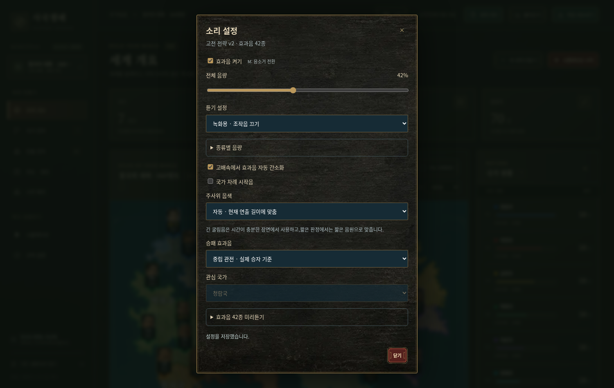

# v0.24 검증 · 2026-10-25

## 범위

첨부 고전 전략 효과음팩 v2를 UI에 적용한다. 엔진26·난수·게임 규칙·세계/실행/역사 저장 형식은 v0.23과 동일하다. src/engine,src/model,src/storage,src/ui/playback.js는 변경하지 않았다. 기존engine25 기록도 당시 규칙으로 복원해 화면에 소리를 붙인다.

## 자동 검사

- `npm test`:334개 통과(기존309개+오디오25개),실패0.
- `npm run check`:177개 JavaScript 파일 구문 통과.
- `npm run release`:일반/모바일 경량 HTML 생성,루트 실행본과 dist가 바이트 단위로 동일. 둘 다v0.24.0 표기.
-42개 MP3는 제공 팩 SHA256 및 내장 data URL과 일치한다. 원본 수정/재인코딩 없음.
- 오디오 검사:설정 분리/검증,실제 공개 단계,숨긴 판정·미래 결과 무음,0보정 생략/가산/감산,음색 길이·결과 독립,4/8배속 간소화,실제 이동만 재생,중립 수비 승리/관심국 패배,점령 공개,실제 내정 증가,임관/계절/생산,지연 해독 취소,AudioContext 재개,캐시/동시 재생/중요음 우선,녹화용과 미리듣기,중복 방지,정지·남은 구간 재개,해독 도중 정지,고배속 전환,역사 방문/현 경기 장부,건너뛰기,기록/RNG 불변.

## 실제 브라우저

`python tests/studio_v24_smoke.py` — 시스템 Chromium에서 일반판과 모바일 경량판 모두 검사한다. `npm run release` 후 `npm start`로3000번 서버가 실행된 상태에서 사용한다. Playwright Python과 시스템 Chromium이 필요하다. 실제 기록은 기존 fixture 생성기로 재현한다. 브라우저 테스트 의존성은 앱 실행에 필요하지 않다.

- 사용자 조작 전 AudioContext0개. 첫 클릭 후1개만 생성.
- 제공42개를 native decodeAudioData로 해독하고 실제 AudioBufferSourceNode.start까지 연결. 출력 경로 AnalyserNode에서0이 아닌 오디오 신호 측정. 가짜 오디오/재생 목 함수로 대체하지 않음.
- 모든 미리듣기,설정 유지/새로고침,음량42%,녹화용 선택/일반 복귀,M음소거와 스피커 SVG 갱신.
- 전체화면 스피커→설정창→게임 정지,닫기→수동 재개.
- 기존38차례의 실제 공격 판정에서 굴림·보정·점수 확정 소리. 정지 중 새 소리 없음,재개로 같은 확정음 반복 없음. 과거 기록 방문이 현 경기 저장을 변경하지 않음.
-390×844,844×390에서 소리 설정창이 화면 안에 표시되고 스크롤 가능.
- 네트워크를 차단한 단일 HTML에서도 지도·설정·내장 효과음 재생.
- JavaScript 예외0,실패한 외부 자산 요청0.

## 실행본

| 실행본 | 크기(bytes) | SHA256 |
|---|---:|---|
| 일반 |14001869|928cebf0651c949bf7edbb83e6cf72a311d60d02487550e93a69752729320ce0|
| 모바일 경량 |11607249|aa2d63002dc50ad42f3fb13f94489bc7a747916f55c38e9407affdb243fdff29|

## 확인 범위

물리 스피커/이어폰에서 주관적 청감 검사는 수행하지 않았다. 실제 휴대전화의 성능·발열·배터리는 측정하지 않았다. 클라우드 Chromium 검증이며 Windows 더블클릭/file://,모바일 Safari의 사용자 조작 정책과 백그라운드 복귀는 실제 기기에서 추가 확인할 항목이다. 음원 출력 실패가 시뮬레이션 계산을 중단하지 않도록 처리했다. 저장 공간/기기/주소가 바뀌면 브라우저 소리 설정도 별도이며 세계 파일로 이 설정을 옮기지는 않는다.
