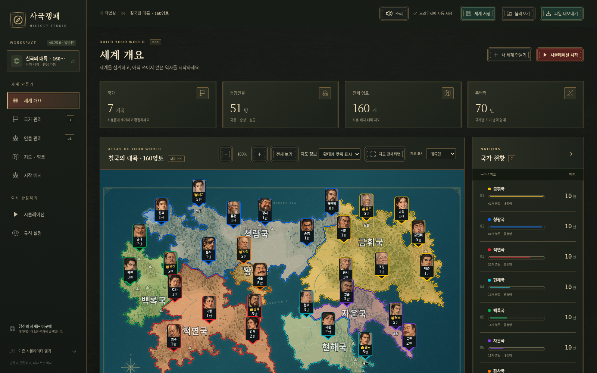
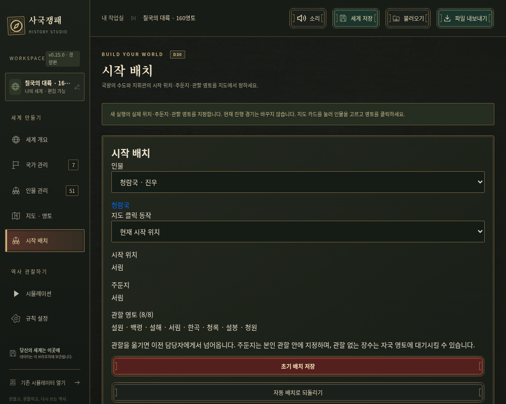

# v0.25 검증 · 2026-10-25

## 결과

- `npm test`:342개 통과,실패0(기존334+국경/초기 배치6+음량 보정2).
- `npm run check`:182개 JavaScript 파일 구문 통과.
- `npm run release`:일반판/모바일 경량판 생성,루트와dist 바이트 동일,v0.25.0.

## 국경·배치와 엔진

160개 ID를 중복/누락 없이 배정하고 나라별 육지 연결을 확인했다. 파랑41/빨강32/노랑42/초록14/보라11/하늘16/주황4. 임원·금천·수원은 빨강,서원·백림·중천·용원만 주황,파랑 수도빙하,초록곡천,주황서원이다. 노랑의16개 추가 지명과 나머지 보라/하늘 영토도 확인했다.

현역 장군6/4/6/2/2/2/1명,23개의 실제 주둔/시작 위치/관할을 검사했다. 모든160영토가 중복 없이 담당되고 관할8칸 이하·자기 관할 안 주둔·자국 내 실제 위치다. 기존 이름/초상/능력·국가 초기병력·규칙·그림/경계/링크·바꾼 지명을 보존한다. 새 배치는 세계 JSON 저장/복원에서 유지된다. 원래160기본 생성기와 기존 경기/기록을 변경하지 않는다.

수동 배치에서 같은 턴 손실 후 수복으로 소유권 목록이 같아져도 지휘관에게9칸이 모이는 회귀 사례(시드777,첫 차례)를 재현했다. 상한 초과 때 해당 나라 배치 잠금을 풀고 기존 재편을 적용해 멈춤을 수정했다. 해당 조건 외의 이전 유효 기록과 원본 v11 대조/옛 저장 복원 검사를 통과했다. 게임 엔진26·세계schema2·실행version1·전투 규칙은 유지한다.

시드777/42/20261017을 각각60차례 진행해 상태 검증,완료 저장/복원,복원 후 다음 난수/결과 일치,과거 첫 차례 재생을 확인했다.

## 실제 브라우저

`python tests/studio_v25_smoke.py` — `npm run release`,`npm start` 후 실행. Playwright Python/시스템 Chromium이 개발 검증에 필요하며 앱 사용에는 필요하지 않다.

- 일반판/모바일 경량판의 실제 단일 HTML에서 새 기본160영토/국가 수/수도/23배치를 확인했다.
- 시작 배치 화면 및 실제 첫 차례 진행/건너뛰기 저장에서 초기 배치가 엔진에 주입된다.
- 이전 저장 세계/진행 기록은 파일을 열어도 유지된다. 명시적 새 영토 배치 적용은 편집 세계만 바꾸고 되돌리기는 이전 수도/소유권/배치를 복원한다. 현 경기 저장 문자열은 동일하다. 새 실행으로 빙하 수도/새 배치를 적용한다.
- 소리 미리듣기/M음소거가 동작하고 네트워크 차단 단일 HTML에서도 효과음이 재생된다.
- JavaScript 예외0,실패한 자산 요청0.

## 음량

42개 원본 MP3는 SHA256 대조와 기존 내장 data URL 검사를 통과했다. 원본을 재인코딩하지 않았다. 별도 분석/보정표는 빌드에서 원본 해시/실행 보정 배율과 일치함을 검사한다. 스테레오 유효 구간 RMS의 음원 간 차이는12.5964dB에서1.3239dB로 좁혔다(원본 manifest gain 포함,전체/종류별 슬라이더 적용 전). 기본 출력1.5배와0.7~2.75 보정을 함께 사용한다.

사용자 전체50%/기존 설정을 유지하고0/음소거는 실제0이 된다. 게임 재생/미리듣기 모두 같은 보정을 쓴다. 최대 음량 합산 출력에는 DynamicsCompressor를 적용한다. native OfflineAudioContext에서 앱의 실제 mixer·원본 MP3 해독·페이드·컴프레서를 통과한 출력은 다음과 같다.

-42종 개별 출력(전체50%): 피크 범위0.030890~0.621387,모두0보다 크고1 미만.
- 전체100%,4음원 동시(`dice_roll_wood_alt/dice_roll/battle_impact/capital_fall`):피크0.923244,1 미만. 중요 사건에 의한 음량 감소를 사용하지 않은 합산도 확인.

## 실행본

| 파일 | bytes | SHA256 |
|---|---:|---|
|사국쟁패 Studio.html|14008912|ea5a574b10f3851f657676758769e2cb4e160ee58e46e11ea8a1ce315390e841|
|사국쟁패 Studio 모바일 경량.html|11614292|ec60d5137482e734d72243186d57a5308d488cec8487ae31b3b02f29b07952d8|

## 확인 범위

음량 수치는 native 오디오 신호 분석 결과이며 물리 스피커/이어폰의 주관적 청감 검사는 수행하지 않았다. 실제 휴대전화 성능·발열·배터리는 측정하지 않았다. 클라우드 Chromium에서 두 HTML을 검증했으며 실제 Windows 더블클릭/file://와 모바일 Safari는 별도 기기 확인 항목이다. 기존 저장 공간이 있으면 자동 교체하지 않으므로 새 영토 배치 적용 후 새 실행을 사용한다. 일반/모바일판 파일 주소가 달라질 때 브라우저 저장 공간도 다를 수 있다.
