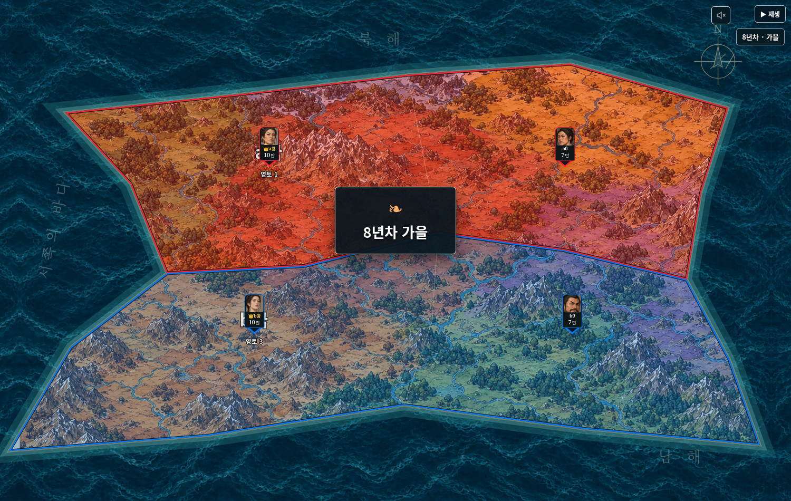
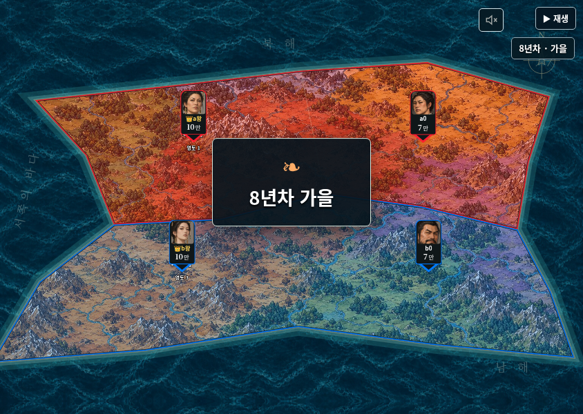

# v0.26 검증 · 2026-10-25

## 자동 검사

- `npm test`:346개 통과,실패0(기존342+진행 제한/달력4).
- `npm run check`:184개 JavaScript 파일 구문 통과.
- `npm run release`:일반/모바일 경량 단일 HTML 생성,루트와dist 바이트 동일.
- 엔진26·세계schema2·실행version1 유지. 선택적인 limitRemovedAt을 기존 저장 포장/큰 저장소/역사 내보내기에 보존한다.

## 원인 재현과 저장

`python tests/studio_v26_storage_smoke.py` — 실제 Chromium localStorage/IndexedDB를 사용한다. 생성기는 기본160영토 시드777을270차례 진행하고100차례의 이전 저장도 준비한다. 기존 방식으로270기록 전체를 작은 저장소에 넣으면 실제 QuotaExceededError가 발생한다. 새 방식은 이를 큰 저장소로 전환하고 작은 pointer만 남긴다.270개 전체 기록과 엔진 상태가 복원되고 다음 차례 RNG도 일치한다. 페이지를 다시 로드한 새 모듈에서도 복원했다.

추가 native 검사:

-300개 전에,실제 quota가 차기 전에도 크기 기준으로100기록을 선제 전환한다.
- 짧은 저장조차 거부되는 조건에서0차례부터 자동 전환한다.131/132차례까지128개 청크 경계를 넘어 저장/불러오기/추가 저장을 검사하며 작은 저장으로 되돌아가지 않는다.
- transaction 중 put 실패/abort 후 종전 pointer와 완료 기록이 보존된다. 재시도한다.
- 큰 저장은 commit됐지만 pointer 갱신이 실패한 경우 이전 pointer로도 동일id의 최신 metadata3차례를 복원한다.
- 예약 중 저장을 취소하고 새 실행을 저장하면 이전 작업이 새 경기의 시드123을 덮지 않는다.
- 큰 저장소가 없는 환경에서는 가능한 작은 저장으로 fallback한다. 두 저장소 모두 실패하면 이전100차례를 보존하고 안내한다. 큰 저장소가 다시 사용 가능해지면270차례 저장을 재시도해 성공한다.
- JavaScript 예외0.

## 제한 해제

`tests/continuation-v26.test.js`는 다음을 확인한다.

- 진행21차례에서 제한 해제 후71차례/36계절까지 계속한다. 병력·영토·위치·기존 기록·RNG를 바꾸지 않고 marker21만 추가한다. 저장/복원 후 다음 결과가 같다.
-30계절/60국가차례로 이미 결산한 경기는 다음31계절로 이어진다. 병력 생산을 중복하지 않고 다이스를 추가 소비하지 않는다. 과거60차례의 제한 결산 기록은 유지한다.
- 해제 전/경계/이후20/21/22/60/61/70차례를 과거 재생해 기록과 대조한다.0차례 해제·위조 marker 거부·이미 통일된 경기 보존도 검사한다.
- 처음부터 제한 없이 다시 진행해도61차례 엔진 상태가 이어간 경기와 같다.
- 달력은 계산된 미래 round보다 현재 보이는 기록을 우선한다. 정지/완료/로드 때도 앞 계절을 건너뛰지 않는다.

## 실제 두 HTML

`python tests/studio_v26_smoke.py` — 일반판과 모바일 경량판 모두 다음을 검사한다. `npm run release`,`npm start` 후 실행하며 Playwright Python과 시스템 Chromium이 필요하다. 앱 실행에는 이 검증 도구가 필요하지 않다.

- 완료된30계절의 예전 저장을 열어 ‘제한 없이 계속’을 누른다. 기존60기록을 유지하며 round31/limitRemovedAt60/제한null을 저장하고 자동 진행한다.
- 전체화면에서 예전8년차 여름→현재8년차 가을,일시정지 후 유지,과거60차례 재생 시 다시8년차 여름을 표시한다. 역사 재생이 현재 저장을 바꾸지 않는다.
-390×844/844×390에서 날짜가 화면 안에 있고 재생·소리·배속 안내와 겹치지 않는다.
- 제한 없음이 켜지면30 입력란이 숨겨지고 비활성화된다. 체크를 끄면 다시 수동 제한을 정할 수 있다.
- 오프라인 HTML 새로고침 후 해제 상태와 기록이 유지된다. 처음부터 재실행도 해제를 이어받아0차례/marker0/제한null로 저장된다.
- 큰 기존100차례 inline 저장을 앱 시작에서 archive로 옮긴 뒤 세계를 저장한다.
- 앱 새 실행 준비에서도 작은 저장 거부 시0차례 archive를 만들고 새로고침 후 복원한다.
- JavaScript 예외0,실패한 자산 요청0.

## 실행본

| 파일 | bytes | SHA256 |
|---|---:|---|
|사국쟁패 Studio.html|14014008|1bc0a629a0635a7ef1229b81417f730fff50f60a5d7dfeba01c7e77bdb42a7a9|
|사국쟁패 Studio 모바일 경량.html|11619388|8b7fa6a930271c3eaad96a7348be1f9830d274ed36134cc61b2322634111ed97|

## 확인 범위

큰 저장소도 실제 기기 여유 공간과 브라우저 권한의 영향을 받는다. 양쪽 저장이 불가능할 때 성공으로 가장하지 않고 이전 저장과 현재 메모리의 기록을 유지하며 내보내기를 안내한다. 클라우드 Chromium의 native 저장소/단일 HTML에서 검증했다. 실제 Windows 더블클릭/file://와 모바일 Safari는 기기 확인 항목이며 휴대전화 성능 측정은 수행하지 않았다. 파일 주소/브라우저가 달라지면 자동 저장 공간도 다를 수 있다. 새로고침 전에 이미 저장에 실패한 미완료/미저장 차례를 이전 HTML의 메모리에서 새 파일로 자동 이동시키지는 않는다.
