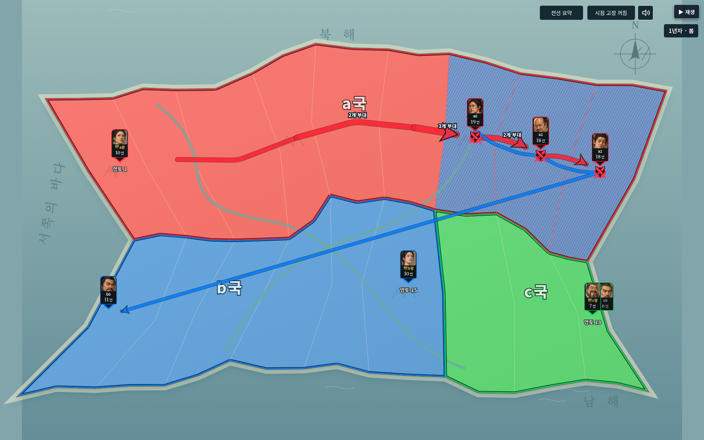
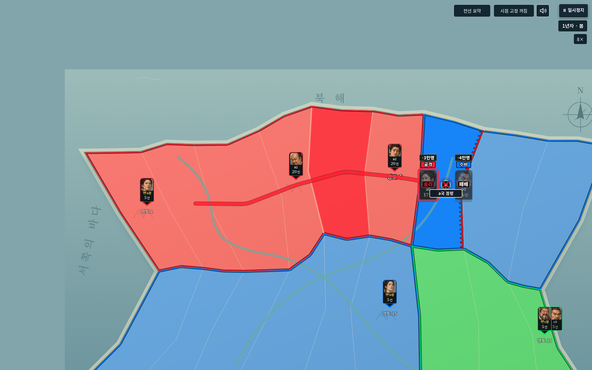

# v0.29.0 검증 · 글꼴·역사 가져오기·공유 전선

2026-10-26, Node24 / Python Playwright / Chromium에서 검증했다. 게임 엔진은 studio-v11-28 그대로다. 세계 schema2·진행 저장 version1을 유지하며, 새 역사 내보내기는 version2, 큰 역사 저장 위치 정보는 version2다. 이전 큰 저장 위치 정보 version1도 읽는다.

## 완료한 확인

- `npm test`: **407개 통과**, 실패0. 기존 원본 대조·전투·생산·왕 부대·혼란/정비·역사/난수 호환 검사를 포함한다.
- `npm run check`: **JavaScript214개 구문 검사 통과**.
- `python tests/studio_v29_smoke.py`: 일반판/모바일판 완성 HTML을 인터넷 차단 상태로 실행했다. 기본160영토, 내장 글꼴4종 로딩, 실제 플랫폼 폰트의 customFont 사용, 라이선스 원문4종 열기/닫기를 확인했다. 앱 예외와 외부 요청 실패 모두0.
- 같은 브라우저 검사에서 **6MiB 넘는 정상 세계 JSON**의 미리보기/취소/가져오기, 실제3차례 역사 가져오기·재생·이어하기·다시 내보내기, genuine engine27 구형 역사 복원, 손상 파일 거부 후 기존 저장 유지/새로고침/다음 턴 진행을 확인했다. 파일 크기 검사는 큰 공백을 포함한 유효 JSON이며, 무한 크기나 임의 대용량 이미지 지원의 증거로 해석하지 않는다.
- `python tests/studio_v29_storage_smoke.py`: 실제 IndexedDB에서 새 기록 저장 위치 갱신 실패·취소 때 기존 세계와 역사가 남는지 확인했다. 구형 current/숫자 청크를 읽어 다음 턴 저장 뒤에도 접두 기록이 남는지 확인했다. 큰 세계 저장/복원과 교체 취소 후 이전 큰 세계 보존도 통과했다.
- Node의 새 가져오기 검사12개: 새 상태/난수 이어하기, 구형 기록 재계산, genuine26/27, 체크섬·판정·최종 소유권 손상, 취소·저장 실패 되돌리기, 제한 해제 경계 보존을 포함한다.
- 공유 경로 검사8개: 서로 다른 출발/목적지, 실제 공유 구간, 인물 중복 제외, 국가·역방향·행동 분리, 굵기 상한, 순환 경로 종료, 분기점 위치 일치, 선택/전체 모드와 원본 데이터 불변을 확인했다. 실제 화면에서도 요약/전체 전환과 진행 중 개별 화살표를 확인했다.
- 혼란 ↓ 바탕 전체의0.5배 변환과 내장 기호 글꼴 사용을 실제 화면에서 확인했다. 기존 혼란·정비 계산은 바꾸지 않았다.
- 글꼴/라이선스 해시, WOFF2 헤더, 런타임 CSS의 OS 글꼴 의존 제거, 다이스 글꼴, 지도 글자 윤곽선과 사용자 원본 보존 검사3개를 추가했다.

## 사용법과 범위

상단 **불러오기**에서 세계·역사 JSON을 선택한다. 선택하면 기존 진행은 일시정지하여 검사·교체 중 자동 진행과 충돌하지 않는다. 읽기/검증 후 세계 이름·기록 수를 확인하고 불러오기를 누른다. 새 역사 파일은 마지막 완료 진행 상태를 함께 내보낸다. 구형 파일은 원래 시드와 기록으로 복원하므로 기록이 길수록 시간이 걸린다. 취소할 수 있다. 연출 중 아직 완료되지 않은 현재 차례는 내보낸 완료 역사에 포함하지 않는다.

‘전선 요약’은 같은 나라·방향·행동의 동일한 실제 구간만 굵게 합친다. 출발과 끝은 개별 유지하고 선택/이동 중 경로는 따로 보인다. ‘전체 경로’는 개별 표시를 사용한다. 겹쳐 보인다는 이유로 실제 이동 경로를 바꾸거나 다른 국가·역방향 선을 합치지 않는다.

5MB 전체 파일 제한은 제거했으나 브라우저 메모리·문자열 크기·기기 저장 할당량은 존재한다. 배경 이미지·다각형·인물 등 개별 필드 검증은 유지한다. 체크섬은 우발적인 손상 확인용이며 진위 인증이 아니다. 역사 시간 분기·새 대형 편집 기능·실제 휴대전화 성능 계측은 이번 범위에 추가하지 않았다.

클라우드 Chromium 정책이 `file://` 접속을 `ERR_BLOCKED_BY_ADMINISTRATOR`로 차단했다. 따라서 완성된 단일 HTML을 HTTP로 제공한 뒤 브라우저를 offline으로 놓고 검증했으며 Windows 더블클릭은 직접 확인하지 못했다. 외부 글꼴/이미지/음원은 요청하지 않았다. 새 저장을 이전 앱이 읽는 것은 보장하지 않으며 두 새 HTML을 함께 배포한다.
