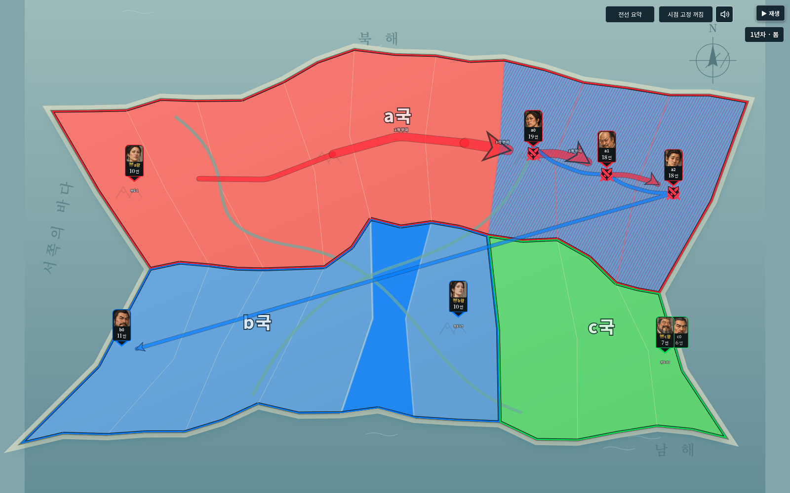
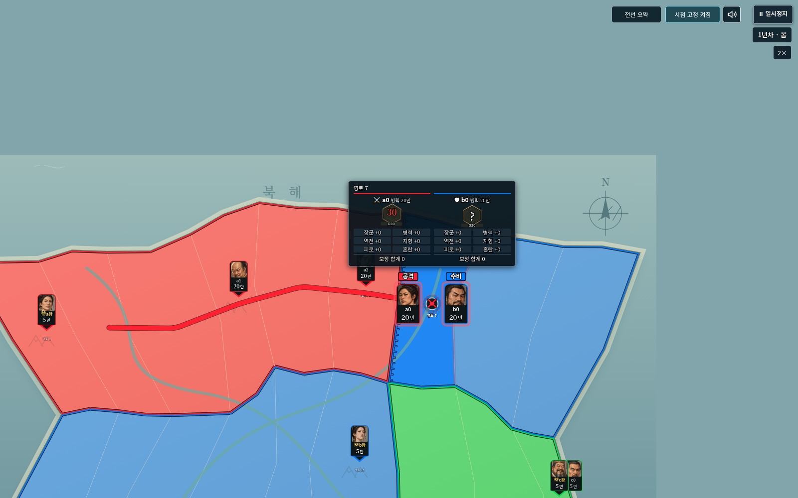
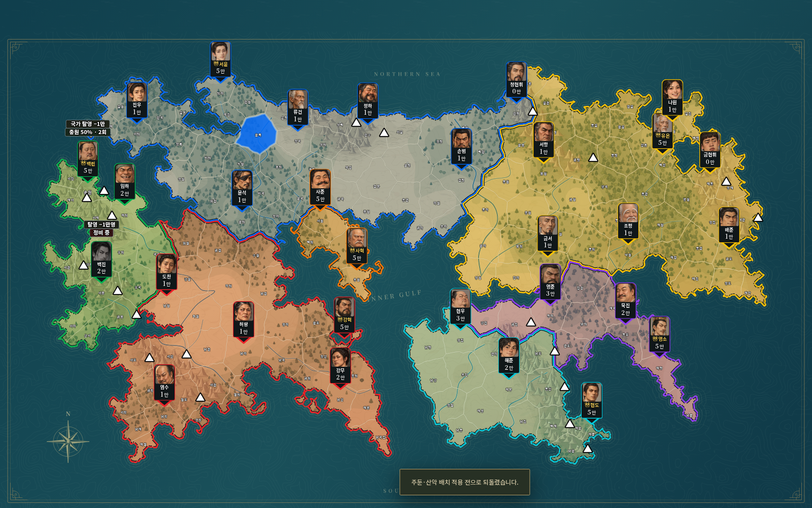

# v0.30.0 · 진행 템포·지도 가독성·시작 배치

2026-10-26, Node24 / Chromium / Python Playwright에서 확인했다. 전투 계산 엔진은 studio-v11-28 그대로이며 세계·진행·역사 파일 형식은 v0.29와 같다.

## 적용한 변경

룰렛 회전900ms를 유지했다. 이동1600→약1333ms, 전투 대형 정렬600→500ms 등 실제 연출은 기본1.2배다. 도착 뒤·판정과 결과 적용 사이·턴 요약의 빈 대기는0으로 줄였다. 승패/손실/성장 확인 시간도 줄였으며 실제 병력·영토를 반영하는 단계와 수동 한 단계 기능은 유지한다. 국가 차례 간 대기는850→40ms, 과거 기록 차례 간 대기는350→40ms다. 따라서 정적인 대기까지 포함한 총 진행 시간은 장면 구성에 따라1.2배보다 더 크게 단축된다. 게임 난수·전투 순서는 바꾸지 않았다.

관전용 영토 이름은9.6→4.8px, 사건 영토 이름은12→6px다. 편집기 글자 크기는 유지한다. 전투 추적 시 화면의 전투 지점을 기존72~76% 높이에서 약61~63%로 올려 중앙 쪽으로 절반 이동시켰다. 전체화면의 지도·버튼·드래그에 내장 금속색 커서를 적용했다.

화살표는 국가 차례마다 최신1 / 이전0.8 / 두 차례 전0.64로 옅어지고 최소0.25를 유지한다. 다른 계절의 기록을 끌어오지 않는다. 공유 구간은 서로 다른 장수의 해당 구간 최신 병력만 합쳐 굵기를 정한다. 같은 장수 반복 통과·전투 횟수를 병력처럼 더하지 않는다. 국가·방향·행동 분리, 출발/도착 가지, 선택·이동 중 개별 경로는 유지한다.25만 초과 합산 병력은 제곱근으로 굵어지며 과도하게 지도를 가리지 않도록 단독25만 화살표의2.4배까지만 넓힌다. 부대 수는6px 별도 레이어로 화살표·지형 이름 위, 장수 카드 아래에 그린다.

충원 저하 안내와 탈영 안내는 정비 표시와 같은8px 흰 글자·검정 테두리·텍스처 박스를 사용한다. 생산/탈영 수치는 기존 규칙을 유지한다.

| 인물 | 시작 위치·주둔지 | 비고 |
|---|---|---|
| 백린 | 송원 | 국왕: 수도도 송원 |
| 임하 | 해림 | 기존 담당 구역 안에서 변경 |
| 백진 | 서봉 | 기존 담당 구역 안에서 변경 |
| 사혁 | 용원 | 국왕: 수도도 용원 |
| 사준 | 서원 | 기존 담당 구역 안에서 변경 |
| 묵진 | 동포 | 동포 담당권도 중복 없이 이관 |
| 유온 | 벽산 | 국왕: 수도도 벽산 |

남포·연하·금진을 산악으로 지정했다. 기존 국가 소유권·초기 총병력·인물 능력/초상·지도 경계·게임 수치를 유지한다. 기존 기본 생성기는 보존하고 새v30 생성기를 사용한다. 기존 세계는 ‘새 주둔·산악 배치 적용’ 뒤 새 실행에서 사용하며 적용 전으로 되돌릴 수 있다. 진행 중인 run/과거 기록은 변경하지 않는다.

## 검증 결과

- `npm test`: **414개 통과, 실패0**. 원본 규칙 대조·실제 구형26/27 역사 가져오기·엔진28·정비/혼란·생산/탈영·장기 기록·난수 재현 검사를 포함한다.
- `npm run check`: **JavaScript217개 구문 검사 통과**.
- 새 테스트7개: 연출 속도와 빈 대기, 실제 공유 병력 합산/동일 인물 중복 제외, 차례별 옅어짐/구간 갱신, 별도 글자 레이어, 일곱 실제 시작 위치·산악,160영토 중복 없는 담당 배정·저장/가져오기/같은 다음 난수, 적용 실패 때 원본 보존을 확인했다. 서로 다른2개 시드에서21차례씩 새 배치를 진행했다.
- 이전 시계 테스트는 고정1500/500ms 대신 현재 장면의 실제 시간·남은 비율을 사용하도록 갱신했다. 정지·8배속 재개·보정 합산·대형 정렬·전선 채우기 검사 의미는 유지한다. 이전 공유 굵기 테스트는 승인된 총병력 기준으로 갱신했다.
- `python tests/studio_v30_smoke.py`: 일반판1600×1000/모바일판844×650에서 일곱 실제 카드 위치, 외부 요청 없는 커서, 절반 이름·작은 부대 수 글자, 정확한 차례별 투명도, 총병력 데이터, 레이어 순서, 전체화면 방향키·배속·S, 이동 중 정지·재개와 올라간 전투 초점을 확인했다. 구형160영토 편집 세계의 배치 적용/되돌리기와 충원 저하·정비·탈영의 실제8px/흰 글자/박스 크기도 확인했다. 앱 예외0.
- `STUDIO_TEST_LABEL=v30 python tests/studio_v29_smoke.py`: 두 완성 HTML에서 오프라인 글꼴·큰 파일·역사 가져오기·재생·내보내기·이어하기, 손상 파일 거부·기존 저장 보존·새로고침·다음 차례 진행을 다시 확인했다. 앱 예외와 외부 요청 실패0.

실제 휴대전화의 프레임 속도나 Windows 더블클릭을 직접 측정한 것은 아니다. 이 클라우드의 file:// 관리자 차단 때문에 완성 HTML을 HTTP로 받은 뒤 인터넷을 끊어 검증했다. 새 시나리오에서의 승자 분포 재조정은 요청 범위에 포함하지 않았다.
