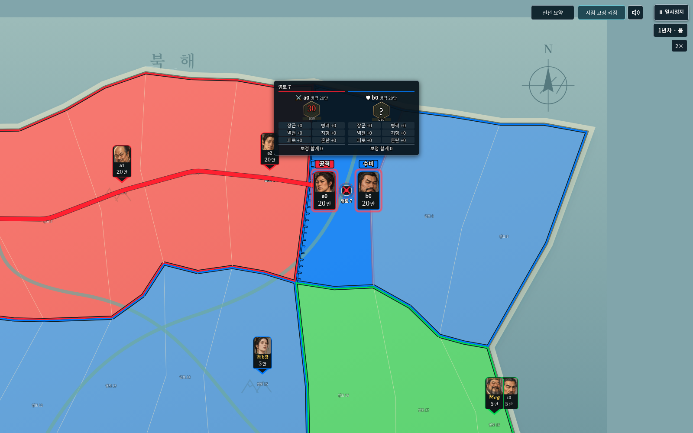
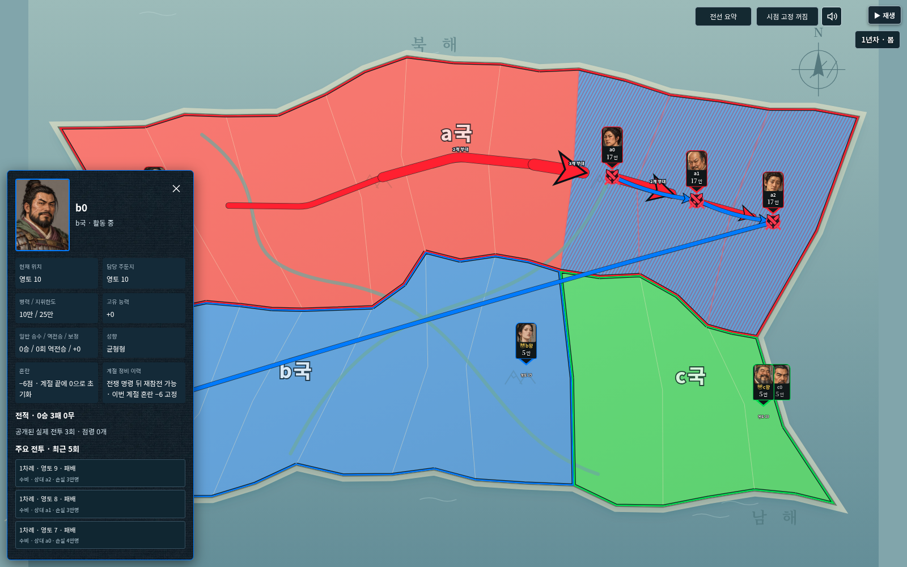
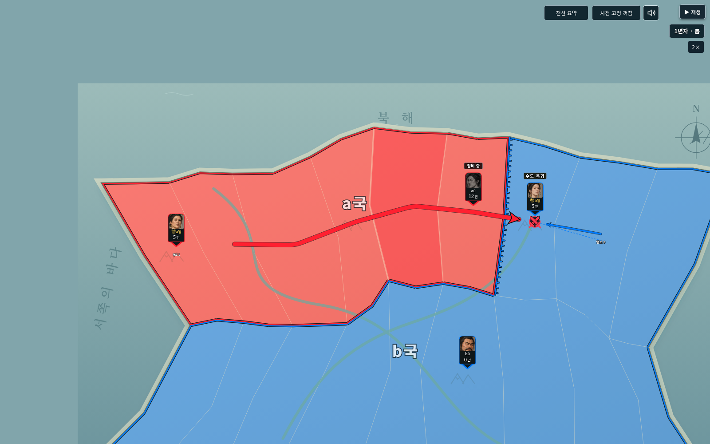

# v0.31.0 · 계절 정비 감점·왕 수도 방어·전투 시점

2026-10-27(한국 시간). Node24 / Chromium / Playwright로 확인했다. 새 계산 엔진은 studio-v11-29이며 세계schema2·진행version1·역사version2를 유지한다. 이전 엔진28 이하의 저장과 과거 규칙은 보존한다.

## 변경 내용

- 신규 `seasonRestConfusion`: 최종 점수 차·잔여 병력·첫 참전 병력 비율·혼란 한도 등 어떤 원인으로든 정비에 들어가면 그 인물에게 `restedThisSeason`을 기록하고 혼란6을 고정한다. 전쟁 명령 종료 시 정비는 풀리고 재참전할 수 있지만, 그 계절의 전투는 공격·수비 모두−6점이다. 계절 종료 시 혼란과 이력을 함께 지운다. 후임 장수·국왕은 이력을 물려받지 않는다. 구형 정비 시0 초기화보다 우선한다.
- 신규 `royalCapitalGuard`: 현재 수도와 직접 육지 인접1칸의 자국 영토에만 기존 왕 수비 자격을 적용한다. 먼 구원은 하지 않는다. 생존 왕은 승/무/패 판정 뒤 현재 수도로 복귀한다. 수도 함락은 새 수도로 복귀하고, 전사자는 움직이지 않는다. 공격·역공 금지와 병력·손실·전사·후임 규칙은 유지한다. 복귀 경로는 실제 사건과 이동으로 기록하며 복귀 자체는 난수를 소비하지 않는다.
- 시점 고정: 전투 영토의 전투 표시점을 가로 정중앙·세로44%에 두고 다이스 창을 카드 위/아래 가까이에 유지한다. S 끄기와 수동 이동·줌·일시정지·배속은 그대로다.

새 기본 세계에는 두 설정이 켜져 있다. 기존 세계는 **규칙 설정 → 새 밸런스 전체 적용 → 시뮬레이션 → 새 실행**으로 사용한다. 진행 중 run의 초기 설정이나 과거 판정을 덮지 않는다. 규칙 화면의 개별 체크도 저장/불러오기를 지원한다.

## 검증

- `npm test`: **426개 통과, 실패0**. 기존 원본 대조·진짜26/27/28 저장·계산·왕/장수·생산·탈영·장기 기록·공유 경로·이동 시계를 포함한다.
- `npm run check`: **JavaScript221개 구문 검사 통과**.
- 새 규칙 검사12개: 모든 정비 사유, 정비 전−2/−4 누적, 전쟁 명령 종료 뒤 실제−6 재전투, 계절 초기화, 임의 설정과 상태 검증, 인접/두 칸 밖 왕 수비 범위, 실제 승·무·생존 패배 뒤 복귀, 새 수도/전사자, 후임 이력 초기화, 저장/재생/다음 난수, 화면 크기별 정확한 카메라 표시점, 새/구형 세계 분리를 확인했다.
- `tests/fixtures/v28-active-history.json`은 수정 전 엔진28로 실제 내보낸3차례 역사다. 그 파일을 읽어 당시 정비 시0 규칙·왕의 구원 범위를 보존하고 원래 전투 증거 재생 및 저장 복원 뒤 다음 상태 일치를 검사했다. 현재 코드로 다시 만든 파일을 구형 실물 증거로 사용하지 않았다.
- `python tests/studio_v31_rules_smoke.py`: 일반판/모바일판 완성 HTML에서 정비 해제 뒤↓↓↓와 상세의−6, 새로고침 후 유지, 실제 왕의 수도 복귀 이동과 최종 주둔지를 확인했다. 앱 예외0.
- `STUDIO_TEST_LABEL=v31 python tests/studio_v30_smoke.py`: 일반판1600×1000/모바일판844×650의 지정 배치, 화살표 시간·병력 합산·레이어, 상태 박스, 커서, 방향키·배속·S, 실제 이동 정지/재개 및 중앙 위쪽 전투 시점을 확인했다. 기존160영토 배치 적용/되돌리기와 현재 역사 불변도 통과했다. 앱 예외0.
- `STUDIO_TEST_LABEL=v31 python tests/studio_v29_smoke.py`: 두 실행본에서 오프라인 내장 글꼴,6MiB 세계, 역사 가져오기·재생·내보내기·이어하기, 구형27, 손상 파일 거부·기존 저장 보존·새로고침·다음 턴을 확인했다. 앱 예외와 외부 요청 실패0.

이전 실행의 새 규칙 소급 적용이나 과거 분기는 추가하지 않았다. 실제 휴대전화 성능·Windows 더블클릭은 직접 계측하지 않았으며 클라우드의 file:// 관리자 차단 때문에 완성 HTML을 HTTP로 받은 뒤 인터넷 차단 상태로 검증했다.
