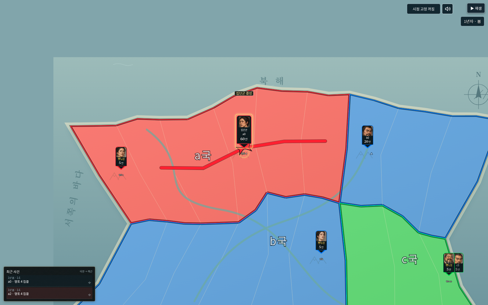
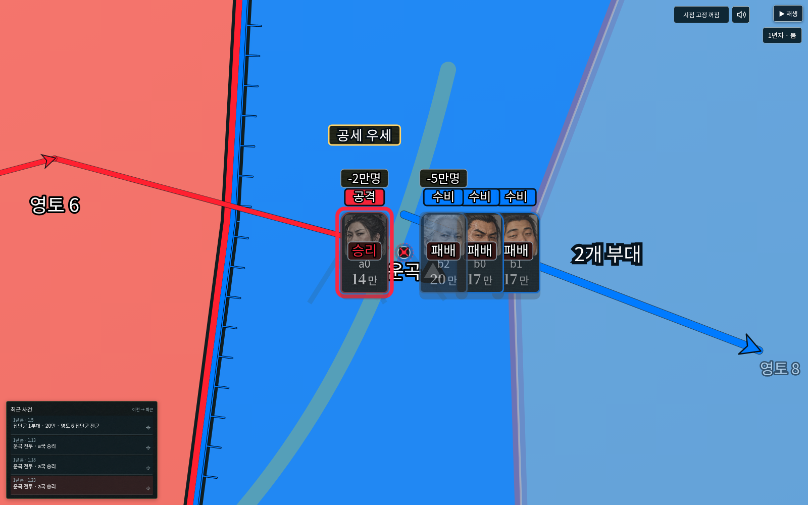

# v0.40.0 검증 기록

기준: v0.39.0(`f3e6c1b`). 일반판 단일 HTML만 배포합니다. 게임 엔진33·세계/실행/역사 형식·전투 계산·난수는 변경하지 않았습니다.

## 확인한 변경

| 항목 | 확인 내용 |
| --- | --- |
| 텍스처 | 제공된 WebP6종 원본을 카드/인물 상세·전투/다이스·내정·역사·최근 사건 배경에서 공유. 사진과 국가색 유지. 기존 CSS의 강제 단색 배경도 보정 |
| 집단군 정보 | 대표38×72 정보 상자, 얼굴 크기와 카드 핀 위치 유지. 일반32×54 카드는 그대로. 실제 브라우저에서 총병력 글자 아래 여백과 이름/얼굴 간격 확인 |
| 로컬 최종 승리 | 같은 영토에서 포갠 카드들의 개별 승패가 끝난 뒤 실제 최종 승리 진영에만 ‘공세 우세’1개. 공격1/수비3·공격3/수비1·좌우 반전·멸망/역공 분리·미공개 결과 차단 |
| 표시 시간 | 만 단위 손실이0이면 기존 손실 단계를 생략해 배지가 너무 짧던 경계 보완. 기존 영토 결과 단계에서만 기본1배속 약400ms 확보. 새 정지 장면이나 계산 사건 없음 |
| 제거 항목 | 지도 반영 중 띠, 관전 설정, 전체 경로/전선 요약 선택, 별도 관찰 화면, 규칙 설정 및 적용 버튼. 이전 브라우저 옵션이 켜져 있어도 고정된 집단군/전선 요약 사용 |
| 기존 조작 | 재생/정지·배속·S·방향키·휠/500% 확대·최근 사건 이동·소리·세계 편집·파일 가져오기/내보내기·역사 재생 유지 |
| 원본 지도 |160개 경계/357연결·원본476개 질감 유지. 원본 그림과 게임의 히트 영역 정렬, 편집 클릭/500% 질감 로딩 확인 |
| 재사용 | 전체화면 stage/SVG/영토 레이어/변경 없는 왕 카드/한풍 그림 DOM이 동일한 노드인지 실제 브라우저에서 확인 |
| 이전 저장 |6MiB 세계·취소·portable 역사 재생/내보내기·실제 이전27 경기 이어하기·손상 파일 후 기존 저장 복구·새로고침 확인 |

## 최적화 측정

`python3 tests/studio_v40_perf.py`는 Git의 v39 실행본과 새 실행본을 같은 오프라인 Chromium에서 비교합니다.1600×1000/DPR1·기본160영토/30카드·100% 확대,4회 준비 후20회 측정합니다.

| 동기 처리 | v39 중앙값 | v40 중앙값 | 감소 |
| --- | --- | --- | --- |
| 같은 지도 화면 재갱신 | 174.5ms | 27.2ms | 84.4% |
| 방향키 지도 이동 | 5.6ms | 4.4ms | 21.4% |

재갱신95백분위: 225.6→30.5ms. 방향키95백분위: 6.2→6.8ms. 이 값은 해당 장면의 동기 처리 비용이며 실제 사용자 기기의 FPS나 모든 전투의 지연 감소율을 뜻하지 않습니다.

지형/국경 재사용, 변경 없는 지도/카드 유지, 매 프레임 경로 재해석/인물 검색 제거, 산악 표시의 측정/쓰기 분리, 내장 이미지의 짧은 로컬 URL 공유를 적용했습니다. 원본 이미지를 줄이거나 다이스/이동·점령 연출을 삭제하지 않았습니다. 화면 밖 지도 질감 추가 보관은8개·추정8MiB로 제한합니다.

## 검증 명령

- `npm test`:524개 모두 통과. 원본/이전 엔진 대조, 캐시 무효화, 마지막 교전 결과와0손실 표시 시간, 실제 저장/복원·재생/RNG 검사를 포함.
- `npm run check`:261개 JavaScript 구문 검사.
- `python3 tests/studio_v40_smoke.py`: 오프라인 HTML·원본 지도·확대/편집·최종 교전 배지·카드 여백/텍스처·판정창 텍스처·정지·멸망·현재 저장 불변.
- `python3 tests/studio_v40_compat_smoke.py`:5MiB 초과 세계·기존 역사/저장·내보내기·손상/취소 보존·내장 상업 이용 글꼴·외부 요청 없음.
- `python3 tests/studio_v40_perf.py`: 위 성능 비교. 실제 휴대전화 성능은 별도 측정하지 않았으며 모바일 실행본도 만들지 않음.
- `npm run release`: 루트와 dist 실행본 일치. 파일 45,405,752바이트, SHA-256 `12c0c1ec385a832cb4db0b31dfd0419ab33d0a14bfde2f39acf9adfb03edfc81`.

실행 환경의 브라우저 관리 정책이 `file://` 이동을 차단하여 직접 파일 경로 열기는 검증하지 못했습니다. 동일한 자체 포함 실행본은 외부 요청을 차단한 오프라인 브라우저에서 원본 지도·이미지·글꼴·가져오기·재생까지 검증했습니다.
