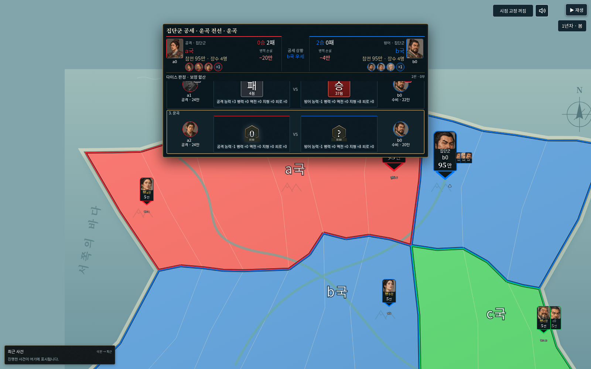
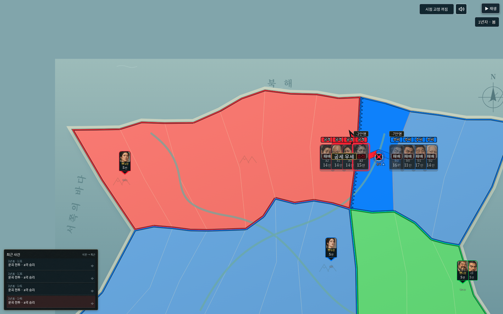

# v0.41.0 검증 기록

기준 v0.40.0(`3ad92d5`). 사용자 승인 범위: 카드1.7·카드 묶음 중앙 우세·큰 다이스 승패·4대4 최적화·장군 다섯 성향과 공격/방어/기동·기존 장수 배정·충원형 승상 수정.

## 게임/파일 검증

- 새 엔진34는33 이하를 읽고, 이전 정의의 officerTraits는false로 고정합니다. 당시 공통 능력·승상 정책을 유지합니다. 세계schema2/실행1/역사2는 유지합니다.
- 기본 장수37명과 후보에 다섯 성향을 배정했습니다. 이름·초상·국가·병력·배치·영토는 배정으로 바꾸지 않습니다. [실제 배정표](officer-roster-v0.41.md).
- 공격/방어는 각 역할의 가산을 대체하며 중복 가산하지 않습니다. 기동은 기존 음수 피로만 조절하고0을 넘지 않습니다. 왕 능력과 수도 방어,별/병력/산악/혼란 규칙은 유지합니다.
- 성향은 합법적 상대/전선 내 목표 선호에만 가산합니다. 추가 거부 판정·명중/기적 주사위는 없습니다.
- 새 실제 전투에서 역할별 능력·최종 점수 합산·병력 총합/지휘한도·저장/복원·동일 역사 재생과 미래RNG를 확인했습니다. 기본 시나리오45차례/99전투도 유효 저장으로 복원했습니다.
- 실제 대패 전사 뒤 필요한 지휘 자리의 후임 임명에서 새 생애 성향·정상 범위 능력·전적0을 확인했습니다. 필요한 자리가 없는 경우 기존처럼 후임을 강제 임명하지 않습니다.
- 충원형 승상은 새 편집 세계에서 모병20/충원력60/보급20으로 자동 준비합니다. 기존 실행의 정책은 당시 값을 보존합니다.

## 화면 검증

`python3 tests/studio_v41_smoke.py`:

- 자체 포함 일반판 HTML을 오프라인 Chromium1600×1000에서 실행했습니다. 외부 요청 실패/앱 예외0.
- 인물 관리의 성향 선택,공격/방어/기동 입력·저장·재열기,왕/승상 기존 설정 유지.
- 실제 기록으로 공격4명·수비4명/한 영토/7개 순차 전투를 재생했습니다. 집결 후 카드의 화면 가로·세로 비율이 일반 왕 카드의1.7배이고 글자가 카드 안에 있는지 확인했습니다.
- 양쪽 점수 공개 후 다이스 위치에 큰 승패 상자와 작은 최종 점수를 표시합니다. 미공개 결과는 표시하지 않습니다.
- 완료된 대결 행이 이후 다이스/보정 단계에서도 동일한 실제 DOM 노드인지 확인했습니다.
- 포갬의 최종 승리 진영 중앙과 ‘공세 우세’ 상자의 중앙이 일치하는지 측정했습니다. 현재 경기 저장은 재생 전후 동일했습니다.

`python3 tests/studio_v41_compat_smoke.py`:

-6MiB 세계·취소·portable 역사·실제 이전27 역사·재생/내보내기·손상 파일/새로고침 보존·이어하기를 확인했습니다.
- 상업 이용 확인 내장 글꼴4종/라이선스·혼란 배지·차례 경로 정리를 유지했습니다. 외부 요청 실패/앱 예외0.

## 성능 확인

실제4대4 기록에서 현재7번째 대결 판정표를100회 생성해 비교했습니다. 준비10회 후 Node 성능 시계 중앙값:

| 항목 | v40 | v41 |
| --- | ---: | ---: |
|7개 대결 행 생성 |2.036ms |1.069ms |
|95백분위 |2.916ms |2.279ms |

완료 행의 SVG/문자열과 실제 행 노드를 재사용하고,지도만 표시할 때 숨겨진 판정표 집계를 생략합니다. 수치는 판정표 생성 비용이며 사용자 기기의 전체 FPS나 무지연 보장이 아닙니다. 지도 화질/원본476질감·다이스/이동/점령·전투 수·기록을 줄이지 않았습니다.

## 최종 실행본

- `npm test`:532개 모두 통과.
- `npm run check`:264개 JavaScript 구문 검사 통과.
- `npm run release`: 일반판 하나,루트와dist 동일.
- 파일 45,410,585바이트. SHA-256 `d0a4b9fedbe2b22928d09a79daaab7ded2baf24359ca69344d271e99ceb055ff`.
- 기존 환경 정책으로 `file://` 직접 이동은 차단되어 동일 실행본을 오프라인 HTTP 환경에서 검증했습니다. 실제 휴대전화는 검증하지 않았고 별도 모바일판은 제작하지 않았습니다.

