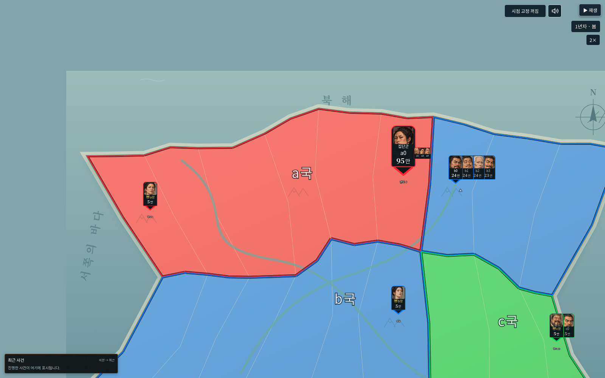
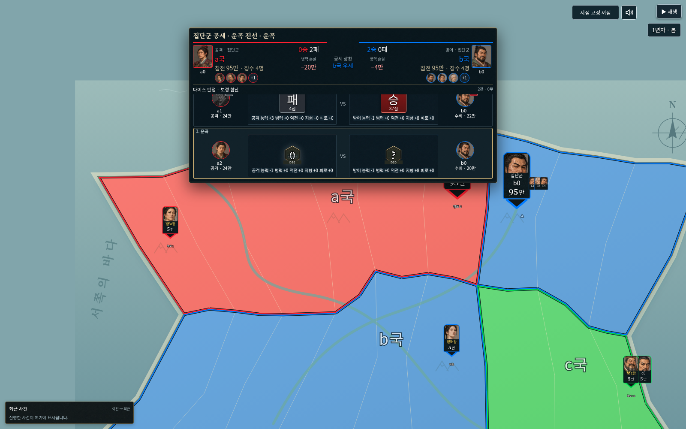
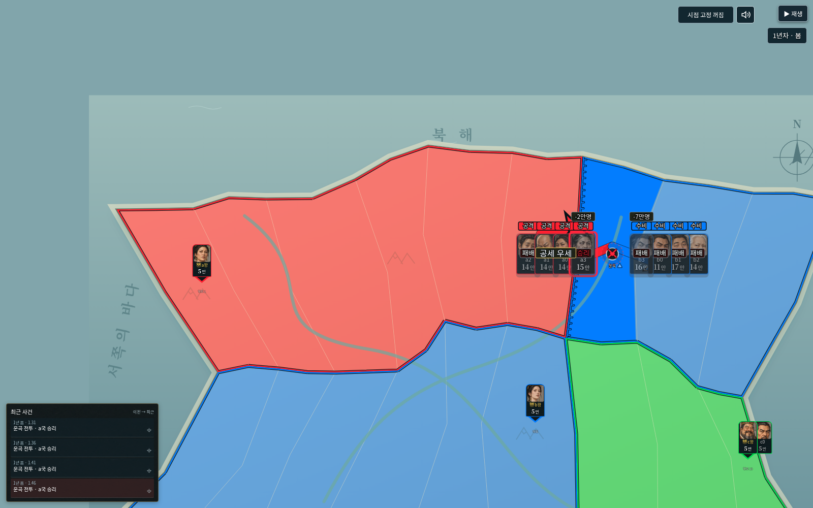

# v0.42.0 성능·호환 검증

기준 v0.41.0(`eda3ddb`). 사용자 요청은 렉 감소다. 게임 엔진34·난수·전투 규칙·파일 형식은 수정하지 않았다. 일반판 HTML 하나를 배포한다.

## 변경

- 지도 레이어의 원문을 정확히 비교한다. 변경 없는 레이어는 작은 슬롯으로 전달하고 실제 SVG/HTML 해석과 노드 교체를 생략한다. 국경·영토·이름·지형·카드가 바뀌면 해당 레이어는 갱신한다. 문맥별 원문 캐시는 전체96개로 제한한다.
- 완료된 다이스 행도 다시 파싱하지 않는다. 현재 판정 행은 기존처럼 갱신하고, 임시 원문은 렌더가 끝나면 해제한다. 아직 공개되지 않은 결과를 캐시로 앞당기지 않는다.
- 원본 한풍 지도는 별도 SVG 표시 면에 두고 전경과 동일한 viewBox로 움직인다. 원본 그림/476질감·보이는 셀 해독/화면 밖8개·8MiB 캐시 정책을 유지한다.
- 지형 검사에서 큰 좌표 JSON의 반복 생성을 없애고 복사본과 직접 비교한다. 좌표/구멍/중심/순서·크기·되돌리기를 계속 감지한다. 병력 숫자 서식기를 공유하고 변경 없는 산악 표시의 위치 재측정을 생략한다.

## 측정 조건과 결과

`python3 tests/studio_v42_perf.py`는 동일한 오프라인 Chromium1600×1000/DPR1에서 Git의 v41 실행본과 새 실행본을 비교한다. 각 장면4회 준비 뒤30회 측정한 동기 처리 시간이다. 임시 가짜 재생 시계와 별도로, 시계 설치 전 보관한 실제 performance.now를 써서 CPU 처리 비용을 잰다.

| 장면 | v41 중앙값 | v42 중앙값 | v41 / v42 95백분위 |
| --- | ---: | ---: | ---: |
|160영토 지도 재갱신100% |21.6ms |4.1ms |24.8 /8.3ms |
|160영토 지도 재갱신500% |21.7ms |3.3ms |26.9 /11.5ms |
|방향키 지도 이동100% |3.9ms |2.6ms |5.4 /5.0ms |
|방향키 지도 이동500% |3.8ms |3.4ms |4.0 /3.8ms |
|4대4 기록의 다이스 판정 중 재갱신 |9.4ms |5.5ms |11.1 /5.9ms |
|같은 기록의 보정 합산 중 재갱신 |7.4ms |4.0ms |8.2 /4.5ms |
|같은 기록의 연속 상대 포개기 |6.0ms |2.7ms |6.9 /3.7ms |

첫4개는 기본160영토/30카드 지도다. 마지막3개는 작은 검증 세계에서 실제 엔진이 기록한 공격4명/수비4명·7개 순차 교전이며, 큰 지도 전체의4대4 FPS 측정으로 해석하면 안 된다. 재갱신은 시점 고정 스위치를 이용해 기존 앱의 전체 화면 갱신 경로를 호출했다. 측정 스크립트의 가짜 시계로 실제 CPU 시계를 덮어써0ms가 나오던 초안은 폐기하고 위 값으로 다시 측정했다.

160영토 재갱신 중앙값은 약81% 감소했다. 이 수치는 해당 화면의 동기 처리 비용이며 사용자 PC의 전체 FPS·녹화 성능·모든 장면에서 같은 감소율을 보장하지 않는다. 별도 실행파일 포장이나 지도 축소로 얻은 값이 아니다.

## 화질과 실제 화면

-100%·500% 원본 배경/국경/클릭 영역의 좌표를 비교했다. 앞뒤 SVG의 viewBox가 일치하고 원본476개 질감 셀을 유지한다.
- 같은 초기 화면 PNG의 RGB 채널 평균 차이는0~255 기준100%에서0.124,500%에서0.00045다. 별도 합성 면의 미세한 안티앨리어싱 차이는 있지만 원본 자산을 축소/압축/교체하지 않았다. 원본 ZIP/그림 해시 검사는 기존 테스트를 유지한다.
- `python3 tests/studio_v42_smoke.py`: 실제4대4/7개 판정, 완료 행과 영토/이름 레이어의 실제 DOM 보존,큰 승패 상자·1.7배 집단군·중앙 우세·인물 성향 편집·오프라인·역사 재생 후 현재 저장 보존 통과.
- `python3 tests/studio_v42_editor_smoke.py`: 영토 이름/소유권/산악 갱신,기본 지도/한풍/사용자 배경 전환과 오래된 배경 정리,1~5배 확대에서 산악과 지명 간격,편집 저장/새로고침 통과.
- `python3 tests/studio_v42_compat_smoke.py`: 내장 상업 이용 확인 글꼴/라이선스,6MiB 세계/취소,portable 역사 내보내기/재생,실제 구버전27 기록 이어하기,혼란 배지·차례 경로 정리,손상 파일 가져오기 후 현재 저장 보존 통과. 앱 예외·외부 요청 실패0.

실행 환경 정책상 file:// 직접 열기는 차단되어 자체 포함 HTML을 오프라인 HTTP로 제공해 검증했다. 실제 사용자 PC/휴대전화와 외부 녹화 프로그램은 측정하지 않았다. 새 모바일판은 만들지 않았다.

## 검사와 배포 파일

- `npm test`:536개 통과. 원본 대조·구버전 저장/역사·동일 RNG·새 캐시 무효화/범위/해제 검사를 포함한다.
- `npm run check`:268개 JavaScript 구문 검사 통과.
- `npm run release`: 일반판 실행본과dist가 동일하다.
- 파일45,413,507바이트. SHA-256 `a6169d1dce6b6701fa16ae69619b18a4adc816762280bc20fa56deea3d3992f2`.

