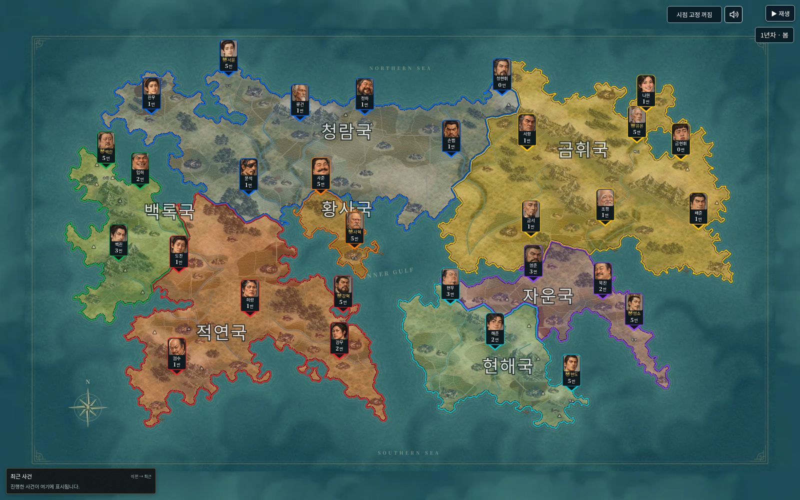
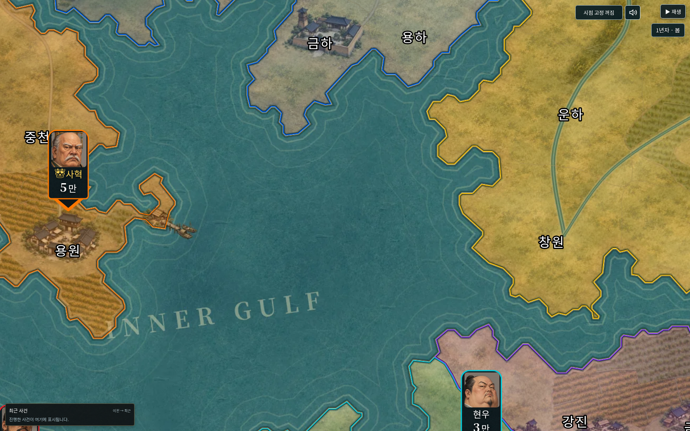
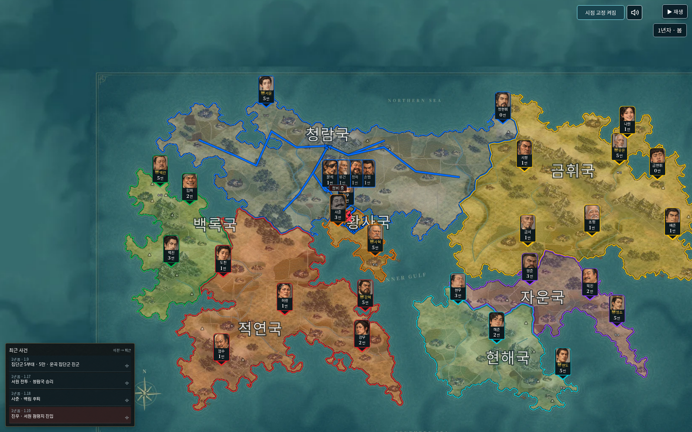

# v0.43.0 확대·이동과 점령 빗금 검증

기준 v0.42.0(`054cb62`). 사용자가 배경 해상도/도형 부담을 낮추고 줌·이동·점령의 실제 버벅임과 깜빡임을 고치는 안을 승인했다. 엔진34·게임/RNG·세계/역사/진행 파일 형식은 변경하지 않았다. 일반판 HTML 하나다.

## 배경과 표시 구조

- 원본ZIP·추출SVG·manifest·160개 게임 경계/357연결은 그대로 보관한다. `scripts/bake-han-map.py`가 기존 source SVG와 sea/terrain 상세 이미지,상업 이용 확인 OFL 글꼴을 한 번 그려 WebP로 합친다.
- 외곽 바다2304×1536/본 지도1536×905를 바탕으로 두고3072/6144 상세 단계는512픽셀 타일로 나눈다. 타일1픽셀 겹침으로 경계 이음새를 줄인다. 배경 품질 조정은 승인된 변경이며 실제 영토 선택·국경·지명·장수 사진/글자는 별도 SVG/HTML을 유지한다.
- 플레이 중 배경의 SVG 요소는8825→125개,배경 마스크는471→0개다. 확대/이동 때 수천 개의 원본 장식 도형과 가림 효과를 다시 그리지 않는다.
- 움직이는 동안 기존 그림을 유지하고120ms 정지 뒤 필요한 타일만2개씩 읽는다. 준비 전 이전 그림을 지우지 않는다. 단계별 보이는 타일 예상48MiB,추가 화면 밖16MiB 정책과 보기 해제 시 URL/타이머 정리를 적용했다. 바탕/이전 단계까지 합친 절대 메모리 상한은 아니다. 검증한500% 장면의 집계는약33.3MB였다.

## 실제 화면 갱신 측정

`python3 tests/studio_v43_perf.py`는 동일한 오프라인 Chromium1600×1000/DPR1에서 Git의 v42와 새 실행본을 비교한다. 이 환경은 headless 소프트웨어 합성을 사용한다. 가짜 시계 없이 requestAnimationFrame 사이의 실제 간격을 잰다. 각 조작을 한 번 준비하고18프레임 조작 중 첫4개를 버린14개 간격을 비교했다.

| 실제 조작 | v42 중앙값 | v43 중앙값 | v42 / v43 최대 관측 간격 |
| --- | ---: | ---: | ---: |
|휠 확대·축소 |864.7ms |32.2ms |952.1 /36.8ms |
|방향키 지도 이동 |448.7ms |31.7ms |529.3 /36.4ms |

확대 중 새 버전은 바탕/기존 그림을 유지하다가 조작 후 상세 타일을 바꾼다. 이 품질/로딩 정책 변경까지 포함한 실제 사용 동작 비교다. 위 수치는 해당 검증 환경의 짧은 관측값이며 사용자 PC·고해상도 녹화·다른 브라우저에서 같은 FPS/무지연을 보장하지 않는다. v42의21.6→4.1ms는 JavaScript 갱신 경로의 비용이었으며,위 화면 갱신 간격과 별개다.

## 빗금 안정성과 실제 기록

- 이전 fill은 조사한 한 영토70% 시점에서920개 작은 삼각형 조각/47,030문자였다. 새 fill은같은 영역의 연결된 링1개/3,438문자다. 기존 거리장을 사용하며 별도의 전투/점령 판정을 만들지 않는다.
- 세 실제 영토의 다양한 진행률에서 격자 삼각형의 독립적인 선형 보간값과 새 외곽선 내부 여부를 대조했다. 이미 채운 점이 뒤 시점에 사라지지 않는다.0/1 완성,구멍 규칙,기존1~3영토 순차 진행을 유지한다.
- 개별 남은 영역/새 국경은 필요한 경계 상자만,옛 국경도 게임 영역만 가림 처리한다. 완료/대기 중인 영토의 클립 d를 매 프레임 다시 쓰지 않는다.
- `python3 tests/studio_v43_capture_smoke.py`는 기본160세계의 실제 엔진/기록8차례를 가져와 재생한다. territory-066에서62단계/222개 내부 검사점을 확인했고 채운 영역이 단조 증가했다. 일시정지100ms·재개에서 클립이 초기화되지 않았다.
- 같은 실제 화면에서 이미 칠한 내부 픽셀을65% 이후와90% 이후에 비교했다. 움직이는 카드를 검사에서만 숨겨 구분했고 RGB 채널 변화8/255 이내를 확인했다. 점령 전선 밖의 경계 변화와 배경 품질 교체를 깜빡임으로 잘못 판단하지 않도록 내부 점만 사용했다.
- 다음 국가 차례에서도 빗금이 유지되고 다음 계절 확정 후 지워졌다. 이 기록에서는 국가 멸망으로 다음 계절이7차례에 시작하므로 저장된 실제 seasonStart로 검사한다. 재생 전후 현재 경기 저장은 동일했다.

## 기능/파일 검사

- `npm test`:542개 모두 통과. 원본 대조·게임/RNG·과거 저장/역사,새 외곽선의 면적·완료 재갱신 방지·가림 영역 범위·그림 출처/타일·메모리 단계·예약 줌 기준점/취소를 포함한다.
- `npm run check`:271개 JavaScript 구문 검사 통과.
- `python3 tests/studio_v43_smoke.py`: 실제4대4/7개 전투,현재 행과 완료 행·지도/이름 레이어 보존,1.7배 카드/큰 승패/중앙 우세·장군 성향 편집·오프라인/현재 저장 보존 통과.
- `python3 tests/studio_v43_editor_smoke.py`: 이름/소유권/산악 갱신,기본/합친 배경/사용자 배경 전환·정리,1~5배 확대와 산악 간격,저장/새로고침 통과.
- `python3 tests/studio_v43_compat_smoke.py`: 상업 이용 확인 글꼴/라이선스,6MiB 세계·취소,portable 역사 내보내기/재생,실제27버전 기록 이어하기,혼란/차례 경로,손상 파일 후 현재 저장 보존 통과. 앱 예외/외부 요청 실패0.

환경 정책으로 file:// 직접 이동이 차단되어 같은 자체 포함 HTML을 오프라인 HTTP로 제공해 검사했다. 실제 사용자 PC/휴대전화와 외부 녹화 프로그램은 측정하지 않았다. 새 모바일판/실행파일 포장은 추가하지 않았다.

## 최종 배포 파일

- `npm run release`: 루트와dist가 동일하다.
- 파일21,403,066바이트(약21.4MB). v42의45,413,507바이트에서 줄었다.
- SHA-256 `e9929c546f5e89c362c2b3d2b6cbf8fedfedb93e875c916a499c045f36019c35`.
- 합친 배경 자료6,090,657바이트. 원본 파일을 수정하지 않고 별도로 보관한다.

