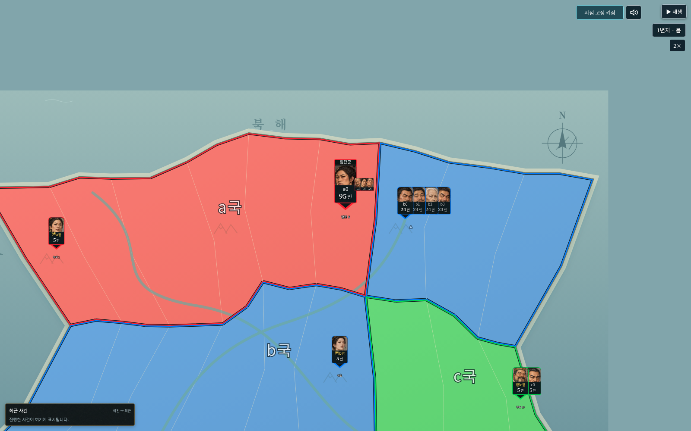
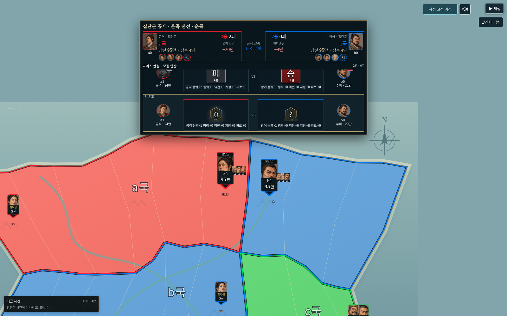
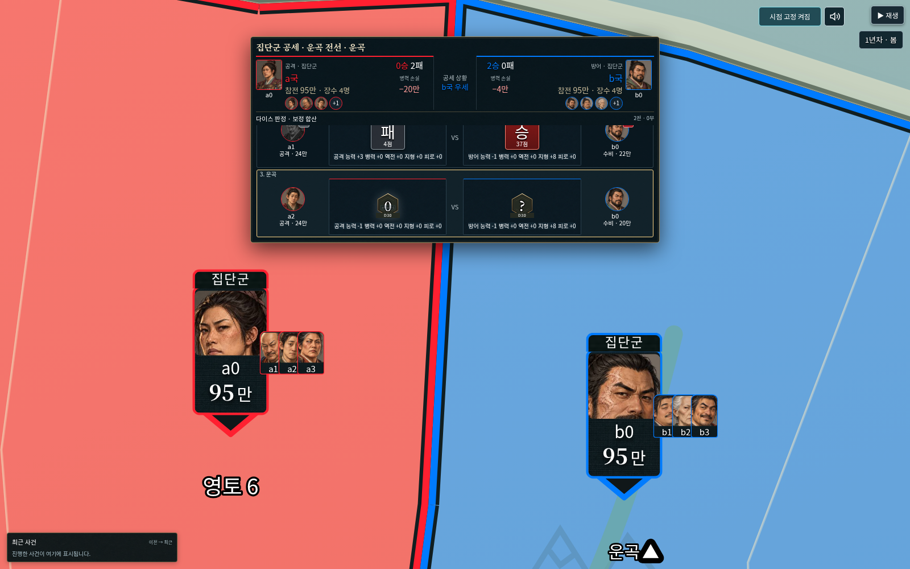

# v0.44.0 사진·집단군 카드와 시점 검증

기준 v0.43.0(`2d7a9ff`). 사용자 요청3개: 사진 양옆 검정 여백 제거,집단군 본체1.4배/사진 위에 붙인 표제,시점 고정 중 다이스 창 아래 가림 방지. 화면만 수정했다. 엔진34·게임/난수·세계/역사/진행 형식과 v43 배경·빗금 최적화는 유지한다.

## 적용

- 일반32×54 카드의 가로 패딩/사진 프레임 여백을 없애 국가색 테두리 안쪽을 사진으로 채운다. 얼굴 crop·초상화 원본/배정·왕의 표시·이름/병력·별은 유지한다. 집단군/보조 사진에도 적용한다.
- 집단군 본체를 가로/세로 모두 일반 카드1.4배로 표시한다. 본체 사진 높이27px를 유지하고 표제8px는 같은 button의 위쪽에 붙인다. 외부 제목 공간까지 foreignObject가 포함하며 예전 버튼 clip-path가 제목을 자르지 않게 한다. 표제도 같은 지휘관 버튼으로 입력을 받는다. 제목 공간은 본체1.4배와 별도이며 사진/이름/병력을 밀어내지 않는다. 결성 확대도1→1.4로 끝난다.
- 현재 공세에서 이미 공개한 공격/수비 집단군만 지도 시점 대상으로 삼는다. 시점 고정 중 같은 배율에서 카메라를 옮겨 대표·표제·보조·핀을 판정창 아래에 둔다. 실제 위치/이동거리/피로/병력/전투 결과는 바꾸지 않는다. 여유가 적은 창에서는 판정창 표시 높이·위치를 조정하며 원래 스크롤을 유지한다.
- 시점 고정을 끄면 임시 배치를 해제하고 같은 국가 차례의 수동 카메라를 유지한다. 개별 전투/지도로 결과 반영 시에는 기존 시점 처리로 돌아간다. 매우 멀리 떨어져 한 배율에 모두 담기 어려운 부대는 현재 공격 집단군을 우선하는 화면 정책이다.

## 실제 화면 검증

`python3 tests/studio_v44_smoke.py`:

- 자체 포함 일반 HTML을 오프라인 Chromium1600×1000에서 실행했다. 실제4대4·7개 전투 기록을 가져와 재생했다.
- 집단군 본체 가로/세로가 일반 왕 카드의1.4배임을 측정했다. 이름/병력 글자가 본체 안에 있고 표제가 사진 위에 있으며 버튼/foreignObject에 잘리지 않는지 확인했다.
- 사진 폭과 버튼의 테두리 안쪽 폭을 비교했다. 왕/장군/집단군에 가로 검정 패딩이 남지 않았다. 표제는 같은 focus-unit 버튼의 자식이며 포인터 입력을 받는다.
-1600×1000,1280×720,900×600에서 보통 확대와500% 확대를 검사했다. 현재 공격/수비 집단군2개의 대표·표제·보조·핀의 실제 경계가 모두 창 아래이면서 화면 안에 있는지 확인했다. 작은 창에서는 날짜·조작부와 겹치지 않게 판정창 위치/표시 높이가 바뀐다.
- 시점 해제 후 방향키로 옮긴 viewBox가 이후600ms의 다이스/보정 진행에도 그대로였다. 다시 켜면 집단군을 창 아래에 배치했다.
- 완료 행과 영토/이름 레이어의 DOM 재사용,큰 승패 상자·4대4 포개기/중앙 우세·인물 성향 편집·역사 재생/현재 저장 보존을 확인했다. 앱 예외·외부 요청 실패0.

`python3 tests/studio_v44_compat_smoke.py`:

- 내장 상업 이용 확인 글꼴/라이선스,6MiB 세계·취소,portable 역사 내보내기/재생,실제27버전 기록 이어하기·혼란/차례 경로,손상 파일 뒤 기존 저장/새로고침 보존을 확인했다. 앱 예외·외부 요청 실패0.

## 검사와 실행본

- `npm test`:544개 통과. 새 카드 구조·핀 기준 배율·카메라 이동의 안정성,기존 게임/RNG·저장/재생을 포함한다. 과거 화면의1.7배/사진 아래 표제 검사는 이번 승인 내용에 맞춰 갱신했다.
- `npm run check`:273개 JavaScript 구문 검사 통과.
- `npm run release`: 일반판 하나. 루트와dist 동일.
- 파일21,405,740바이트. SHA-256 `9726d5d4273c3fec718319061d436537d0f93873a6616bb6d7db82c1f49a88a4`.

환경 정책상 file:// 직접 이동은 차단되어 동일 HTML을 오프라인 HTTP로 제공해 검증했다. 실제 사용자 PC/휴대전화·녹화 프로그램은 측정하지 않았다. 새 모바일판은 만들지 않았다.

