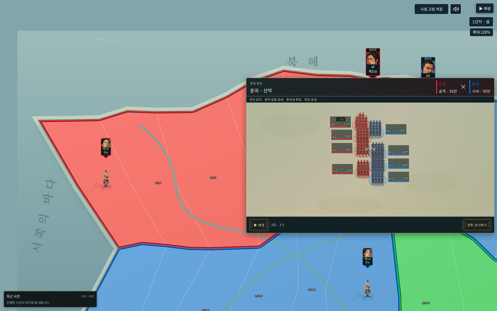
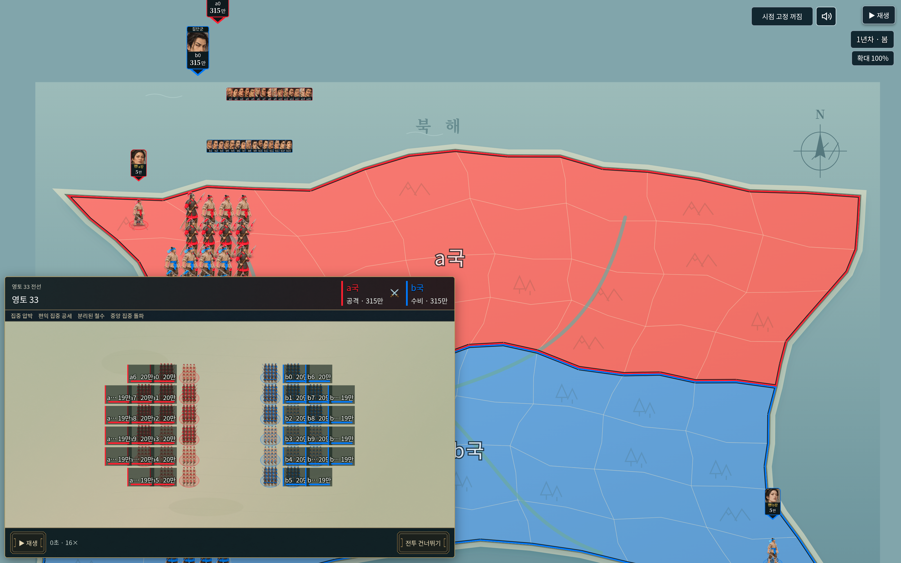
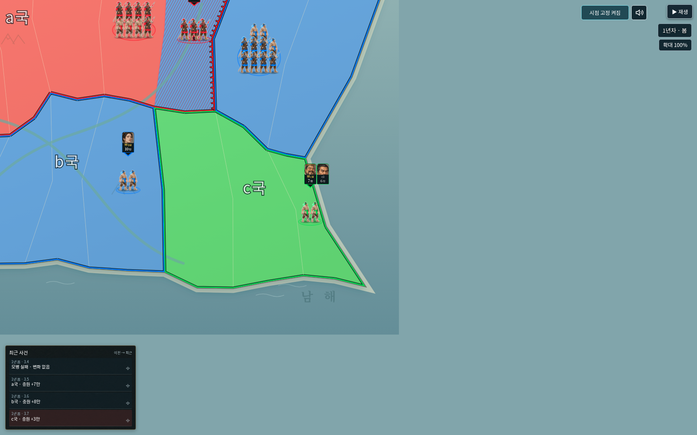

# v0.53.0 검증

## 변경과 범위

지도에 붙는 약¼면적의 전투창과 부대 전체의 동시 교전 궤적,그림 중심/개별 병사 깊이 정렬,지도 확대율,임관 확정 추적을 구현했다. 이번 집단전 개인 최고5연승 이상만 종료 요약에 함께 한 번 표시하며,이전 전투의 생애 연승을 단독전/집단전의 중간 축하에 섞지 않는다. 기존 텍스처/효과음/원본 병사 자료를 사용한다.

수치 판정의 의존 순서와 화면의 동시 움직임을 분리했다. 왕은 방어 부대이며 실제 전사/손실/점령/재편/철수 기록을 유지한다. 엔진38/게임 난수/저장 형식과 실제 거리·피로·병력·별·능력은 변경하지 않았다.

## 자동 검사

- 기존 전체 `npm test`: **627개 통과**,실패0. 이후 추가한 신규8개를 합쳐 **635개 검사 항목**을 확인했다.
- 최종 관련 검사: **33개 통과**.8명 동시 접촉/한 인물 한 꾸러미/교전 중 상대 방향 유지/연속 상대마다 재접근하지 않음/손실 공개의 인과/실제 전사와병력0구분/왕과역공/전선 분리/장수별 병사 수/시점·지도복귀 초기화를 확인했다.
- 개인 연승:이번 집단전의5승→패→3승은 최고5연승,3승→무승부→3승은 미해당,무방비 점령 제외,7연승은7로 표시. 실제32명 장기 공세에서도 종료 때만 표시한다. 이전4승을 가져온 단독전의5승 축하도 차단했다.
- 8개 시드의96국가 차례/32집단전에서 기존 엔진의 난수·세계·결과와 일치한다. 같은 기록·연출 시드는 같은 궤적을 만들고 별도 연출 시드를 바꿔도 최종 수치는 변하지 않는다.
- 지도 창 배치/가장자리 보정,원본 프레임 고정 합집합을 이용한1~16명 그림 중심,오래된 전투 번호보다 확정 임관 위치 우선 및 줌 유지 검사를 통과했다.
- `npm run check`: **333개 JavaScript 파일 구문 검사 통과**. `git diff --check` 통과.

## 실제 브라우저

Playwright/Chromium에서 일반 단일HTML을 외부 네트워크 차단 상태로 실행했다.1600×1000/DPR2와 실제 내보낸 역사 파일을 사용했다.

- 8명 전투:참가자/병력,면적¼,뒤의 지도 표시,동시 교전,정지 중 그림/좌표 고정,DPR캔버스,배속 변경 시 동일 캔버스 유지,지도 이동·확대와 영토 앵커 이동,확대율 출력,종료 요약1배속,상세 기록·복귀·다시 보기·건너뛰기·지도 복귀를 확인했다.
- 실제 사망 기록의 중요 알림1배속/전사 동작과 일반 화면 복귀를 확인했다. 앱 오류/외부 요청0건이다.
- 실제32명/42교전 기록:모든 인물ID32개,초기 병사512명,실제 적·청 병사 픽셀,정지 유지,개별 병사 발Y의 전체 오름차순을 확인했다. 원본 그림/인원 수를 줄이지 않는다.
- 시점 고정 켜기 상태에서집단전→지도→다음2·3턴→완료→방향키 이동의 자동 진행이 오류 없이 끝났다. `nodes.countdowns is not iterable` 재발0건이다.

## 실행본과 한계

루트와dist의 `사국쟁패 Studio.html`은 동일하며,`npm run release`로 새로 생성했다. 일반판 하나만 배포한다. 화면이 좁으면 전투창 폭70%를 사용한다. 많은 부대의 이름표는 작은 창 안에서 조밀해질 수 있다. FPS측정이나 모든 기기/브라우저의 성능 보장은 하지 않았으며,이번 검증은 Chromium의 기능·재생 일관성 검사다.

실행본: 42,820,304바이트 · SHA-256 `dd07aa4904e32ecbc0556733a70adc0629526753ab6c8f355d6d5b3de238f037`
