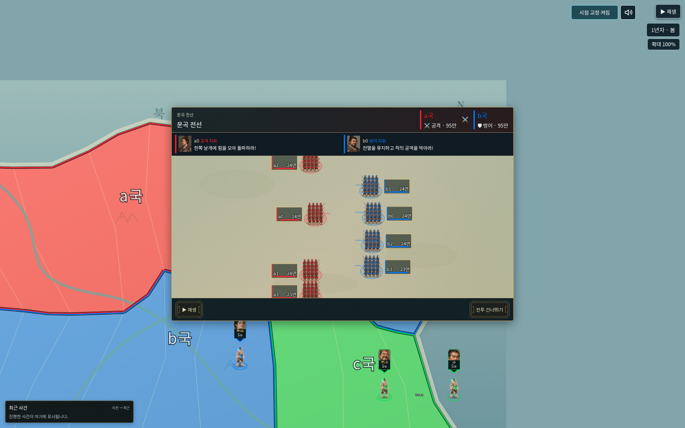
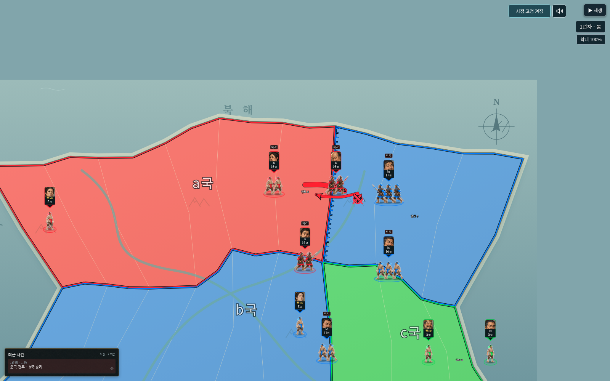

# v0.55.0 검증

사용자가 승인한 동시 후퇴,좁은 지도 대결 배치,2배/4배 촬영 템포,반복 전투 동작,전장 도착 표시,양측 지휘 명령과 진형 이동,다이스 순서와 분리된 동시 교전,집단군 카드1.4배를 적용했다. 엔진/모델/저장 모듈은 변경하지 않았다.

## 자동 검사

- `npm test`: **648개 통과,실패0개**.
- `npm run check`: JavaScript342개 구문 검사 통과. `npm run release`로 만든 루트와dist의 단일HTML이 동일함을 확인했다.
- 새 검사는 반복 공격/방어와 일회성 전사,고정 시드의 동시 교전 및 실제 최종 병력/생사,명령 뒤 진형 이동,전장 표시의 선행 순서,동시 후퇴/효과음,공유 경로의 분리,2배/4배 최소 시간,카드만1.4배 확대,전사 후 재등장 방지를 확인한다.
- 기존 세계/저장/원본 룰/엔진 재현/왕 방어/보급/역사 재생 검사도 함께 통과했다. 기존 중간 피해 순서 검사는 사용자 승인에 맞춰 자유 연출과 실제 최종 값 보존 검사로 변경했다.

## 실제 브라우저

`tests/studio_v55_smoke.py`로 생성된 단일HTML을 Chromium1600×1000,DPR1,외부 연결 차단 상태에서 확인했다. 실제 엔진으로 만든 다대다 역사 파일을2배와4배로 재생했다.

- 전술창 이전 지도 전장 도착 표시,고정된 전투창 위치,양측 공격/방어 및 지휘창.
- 반복 공격/방어 동작과2배/4배의 전투 시간,정지/재생/다시 보기/건너뛰기.
- 종료 후 여러 지휘관 동시 후퇴,실제 이동 중 카드 핀과 화살표 끝의 일치,지도 복귀 때 앱 오류 없음.
- 기본 단위 검사의 병사 묶음 분리와 별도로 화면을 저장해 실제 배치를 확인했다.

[4배속 명령 화면](v55-orders-4x.png) · [4배속 후퇴 화면](v55-retreat-4x.png)

## 범위

전술 움직임은 기록된 결과를 보여주는 연출이며 새로운 전투AI/승패 보정이 아니다. 사용자 승인에 따라 중간 병력 감소와 교전 순서는 주사위의 개별 순서와 다를 수 있다. 최종 병력·생사·영토·전적은 실제 기록을 유지한다. 이번 화면 검증은 데스크톱Chromium이며 모든 브라우저/기기의 성능이나 음향 체감까지 보증하는 검사는 아니다.
