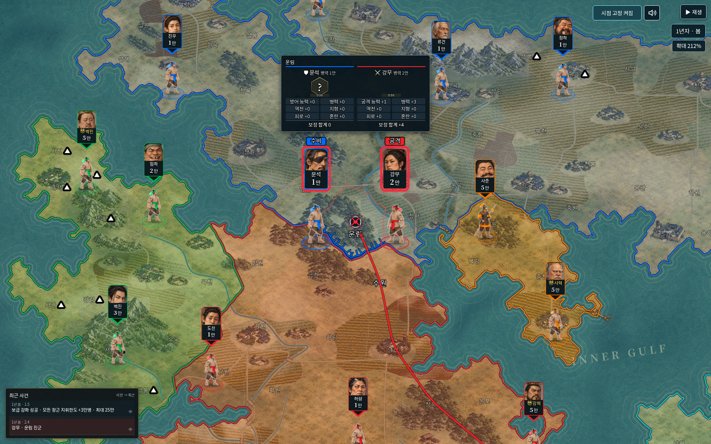
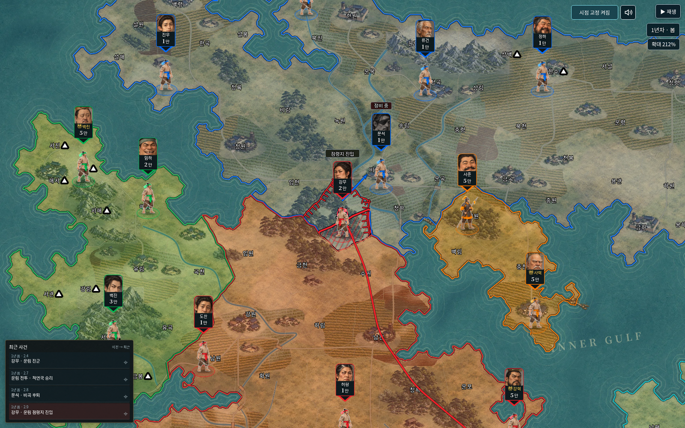
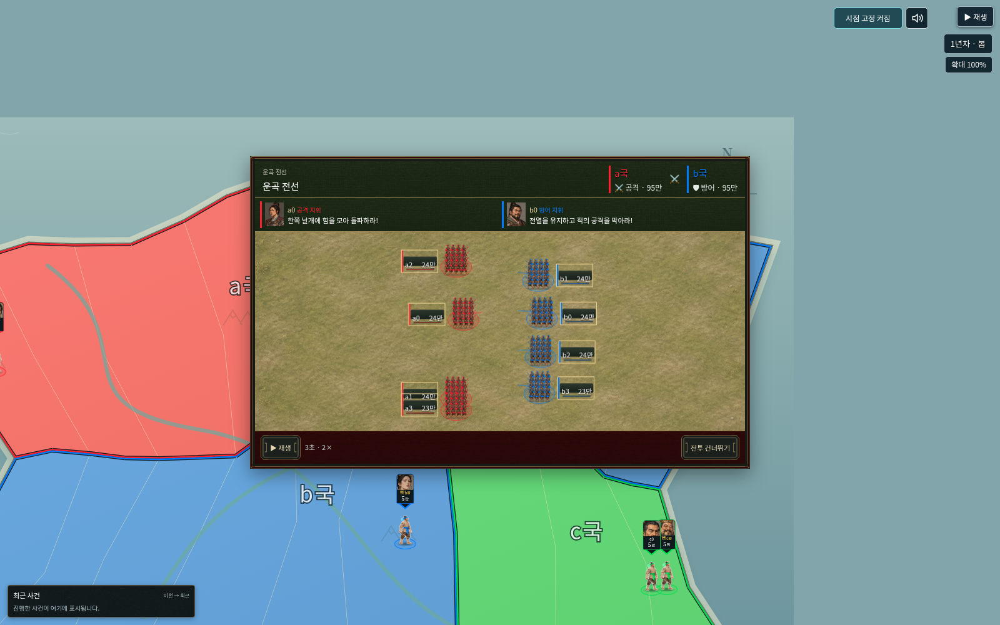

# v0.56.0 검증

사용자가 승인한 지도 시점/위치/점령 순서 마감,신규 이름200개,첨부 전투 배경·UI·효과음을 적용했다.212%는 검수 기준이며 앱의 확대율을 강제로 변경하지 않는다.

## 자동 검사

- `npm test`: **656개 통과,실패0개**. 기존 세계/저장/원본 규칙/전투/왕 방어/보급/역사 재생 검사 포함.
- `npm run check`: JavaScript352개 구문 검사 통과.
- 추가 집중 검사39개 통과. 전술 병력의 위/아래 곡선이 화면 밖으로 벗어나지 않는 마감도 포함한다.
- 신규 검사는212% 점령 후 관리 장면의 시점 유지,지도 요약의 위치/소유권/공개 목록 연속성,해안 영토 내부 자리,오목한 육지 내부 연속 이동,200이름 고유성·후임·구버전 난수/기록 재현,첨부OGG13개 원본 일치,실제 loop 소스·음높이·정지/재개/음소거/4소스 제한을 확인한다.
- 기존v0.55의 ‘최소 간격만큼 매 순간 밀어내기’ 검사는 사용자 보고에 맞춰 ‘다른 부대가 있어도 이동 위치가 달라지지 않기’ 검사로 교체했다. 작은 영토에서는 밀집을 허용한다.

## 실제 브라우저

`tests/studio_v56_smoke.py`는 생성된 단일HTML을Chromium1600×1000,DPR1,외부 연결 차단 상태에서 실제 엔진 역사로 검사한다.

- 실제160지도212%에서VS 양측 병사 중심과 전투 표식 중심 일치.
- 점령 중 전경/배경viewBox 고정 및 일치,이미 채운 영역이 되돌아가지 않음.
- 점령 뒤 대기·명단·정산에 따른 반복 시점 이동 차단. roster에서 실제 새 장수가 임관하면 한 번 추적하는 기존 동작은 허용.
- 전술창의 내장 초지/9분할 테두리,투명 캔버스,실제AudioBufferSourceNode.loop 및 playbackRate1,2배·4배·8배 재생,동시 후퇴와 순차 점령을 확인.
- `tests/map_recap_v56_smoke.py`도 통과했다. 실제 집단전·다중 점령을212%/DPR2/4배속에서 확인했으며 동시에 후퇴한 뒤 순차 진입/무방비 진입/연속 확장으로5영토의 빗금이 유지됐다. 이동하지 않는 제3자 위치와 최종 결과도 일치했다.

[212% 실제 집단전 후 다중 점령 화면](v56-campaign-212.png) · [8배속 전투 소재 화면](v56-battle-8x.png)

## 적용 범위

전투 결과·주사위·피로·병력·영토 규칙은 변경하지 않았다. 신규 이름 기능은 다음 활성화 명령부터 적용하며 과거 이름과 재등용 장수는 보존한다. 첨부 자료의 안내/검수 문구는 외부 참고 자료로 취급했고 제공된 예제HTML/JS를 실행하지 않았다. 실제 기기 전체의 무지연이나 물리 스피커 음량 체감을 보증하는 검사는 아니다.
